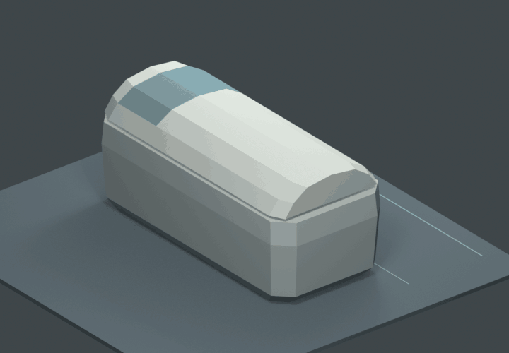

# Room 1：整片舱盖侧滑下收候选 v1

2026-10-13。**待用户审查开合动作与低模轮廓**，没有批准成完整房间的休眠舱母版。

本轮依据用户在对话中明确的要求：下载的 GLB 仅作轮廓与设计参考；模型重新制作、细节简化；玻璃只留头部区域；舱盖先抬起，再沿舱体侧面轮廓向下收；整片盖、不左右分片。当前先做低模、以后再做专门像素贴图与 Godot 导入。

## 直接看动作



GIF 是保存的 Blender 工程实际动画逐帧渲染，使用 720×500 PNG 编码，非生成图像或图片变形。播完停留再跳回起点；动画长度和速度仅供理解路径。

| 状态 | 帧 | 实际输出 |
| --- | --- | --- |
| 闭合 | 1 | [闭合图](evidence/01_closed.png) |
| 整盖竖直抬起 0.12 m | 30 | [抬起图](evidence/02_lifted.png) |
| 向侧方滑动并转下 | 60 | [中间状态](evidence/03_side_slide.png) |
| 整盖贴近一侧竖向收起 | 90 | [收起图](evidence/04_stowed.png) |
| 从端部观察侧向占位 | 90 | [余量图](evidence/05_stowed_clearance.png) |

五张 PNG 均为 1440×1000 实际 Camera 渲染。地面两条细线是原舱边界 X=0.525 与下一舱近边 X=1.225，间距 0.70 m，仅为测量辅助。

## 本轮造型与参考关系

- 新建连贯的卧式舱身、内侧衬面、简单承托面和一个整体舱盖。外壳用少量折面塑造轮廓，不增加沟槽、格栅、按钮、外露机构或装饰。
- 闭合外包保持 **宽 1.05 × 长 2.30 × 高 1.00 m**。样本以自身底面中心为原点，长轴 Y；回放到 P11 时原点对应工程坐标 (1.775, 7.65, 0)。未移动全室舱位或修改工程布局。
- 头窗设在盖上 +Y 的 0.50…0.96 m 区间；蓝色只标示观察区。此次不做透明／磨砂 Shader、人体或内饰细节。
- 舱盖端部与面板作为同一个连续封闭 mesh，厚约 0.022 m，随同一控制节点刚性运动。没有折叠、伸缩或隐藏盖片来完成动作。
- 只用纯色材质，UV 为待整理的面投影占位，**不是已完成的生产用像素贴图 UV atlas**。
- 形体参考来自用户提供的截图，以及 GLB 元信息标注的 Artboard Silvio Pinheiro / [Scifi - Cryogenic Sleep](https://sketchfab.com/3d-models/scifi-cryogenic-sleep-3e65d80f30fb4a9e81f721f1c0cb8474)。本目录没有导入、修改或重新分发原 GLB，也没有复制其拓扑、动画、材质或内部人物。FreeCAD 只提供外包和 P11 位置数据。

## 动作与空间结果

先竖直抬起，再通过整盖横移 + 绕舱长轴旋转向侧面收起。演示采用 **+X 一侧**；全室左右朝向与人物出舱侧尚未确认。控制器只是动画轨迹，不代表已经设计好导轨／连杆。

对完整路径每半帧采样，共 180 个状态，结果见 [motion_measurements.json](motion_measurements.json)：

| 测量 | 本候选值 |
| --- | --- |
| 起始抬升 | 0.120 m |
| 动作最高点 | 约 1.154 m |
| 运动时超出闭合舱侧边最大值 | **约 0.339 m** |
| 0.70 m 间距在最大外扩时剩余 | **约 0.361 m** |
| 完全收起时超出舱侧边 | 约 0.265 m，间距剩约 0.435 m |
| 盖子最低点距地面 | 约 0.030 m |
| 与舱身、承托面的 mesh 表面相交 | 180 个采样状态中未检出 |

**这说明整片下收会占用一侧的明显空间。** 0.36 m 的余量不能作为自然上下舱或人员通行通过的依据；建议后续优先评估从另一侧下舱，但尚未将建议写成全室朝向规则。也未证明相邻两个盖子同时打开时互不干涉。

检测是离散时刻的 mesh 表面相交与包络测量，不是连续扫掠、机构运动学或人体工效验证。没有通过扩大房间或压缩已确认通道来隐藏这个结果。

## 文件与继续编辑

- `room1_pod_whole_lid_motion_v1.blend`：Blender 5.0.1；时间轴 1—108，24 fps。打开默认闭合；播放时间轴查看动作，关键状态有标记。
- `build_pod_motion.py`：新建空场景，构建自有低模、动画、测量和五张图，仅写此目录。重复运行不叠加模型。
- `motion_poses.json`：轨迹参数；它们是候选值，可继续调整。
- `check_saved.py` / `saved_check.json`：重新读取保存工程，核对外包、整盖单一连通封闭 mesh、头窗随盖运动、抬升与侧收关键帧等。静态／采样通过不等于用户美术验收。
- `render_preview.py`：Blender 渲染预览序列到忽略的 `.preview_frames/`。
- `package_preview.py`：普通 Python + Pillow 将实际帧编码为 GIF。原始预览帧缓存不上传。

在此目录运行，按本机安装位置修改 Blender 路径：

```powershell
& 'C:\Program Files\Blender Foundation\Blender 5.0\blender.exe' --background --factory-startup --python-exit-code 1 --python .\build_pod_motion.py
& 'C:\Program Files\Blender Foundation\Blender 5.0\blender.exe' --background --factory-startup --python-exit-code 1 --python .\check_saved.py
& 'C:\Program Files\Blender Foundation\Blender 5.0\blender.exe' --background --factory-startup --python-exit-code 1 --python .\render_preview.py
python .\package_preview.py
```

本轮结束于动作与单件轮廓候选。主角舱位、实际出舱动作、整室盖子朝向、最终盖轮廓与内部深度仍待审查；没有把本候选复制为 20 舱，也没有改动 v1/v2、房间或 Godot。
