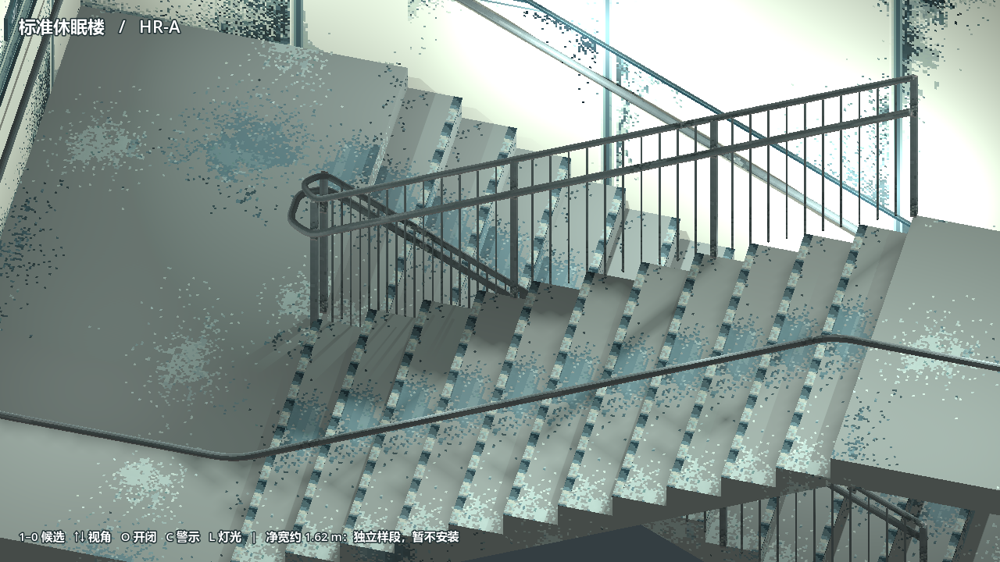
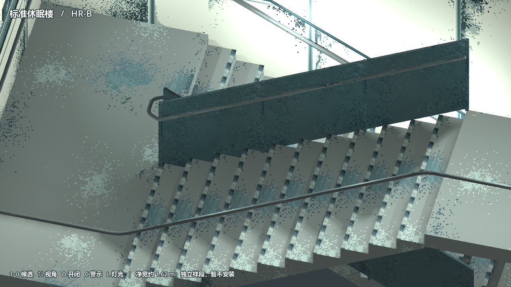
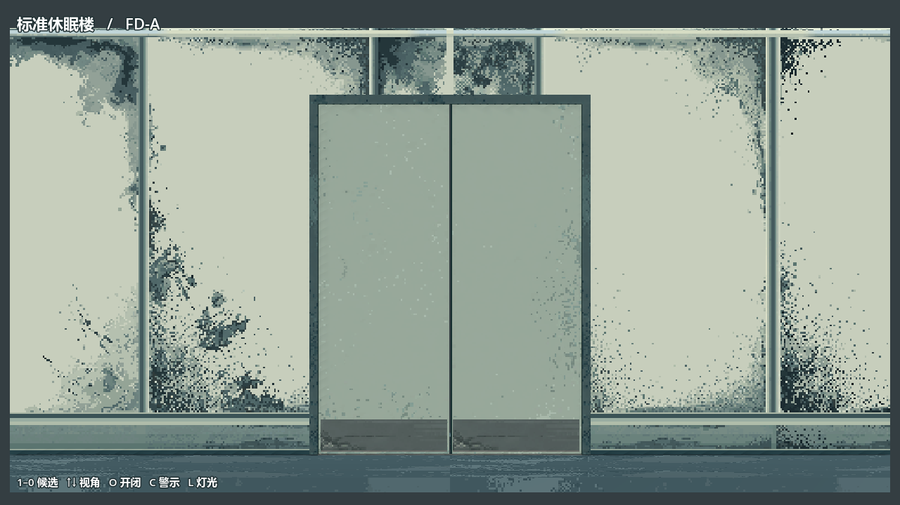
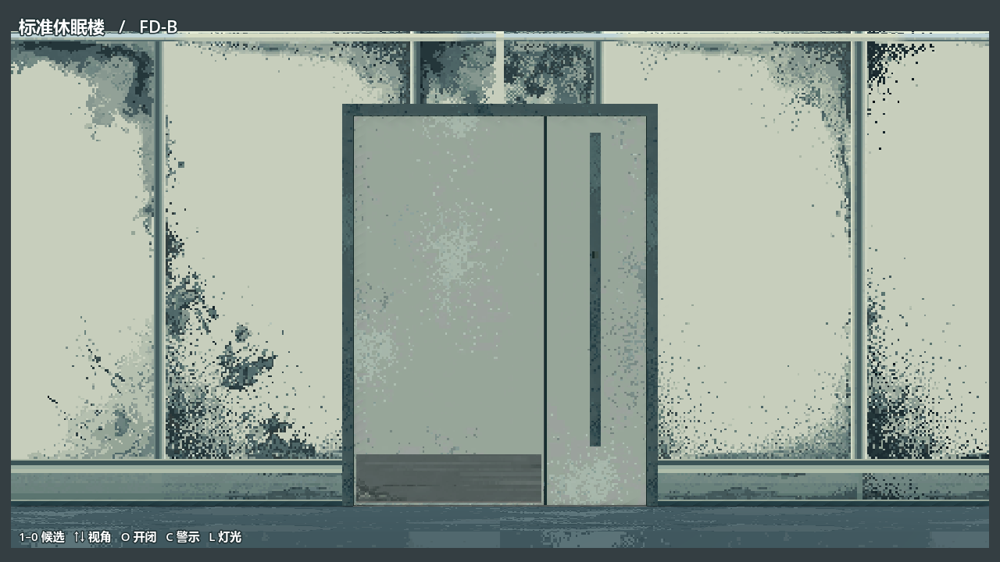
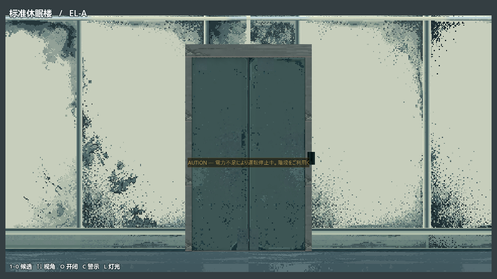
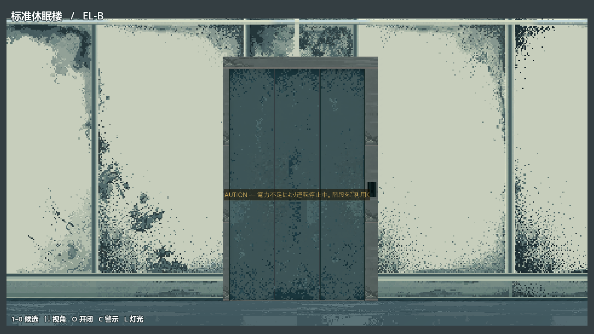
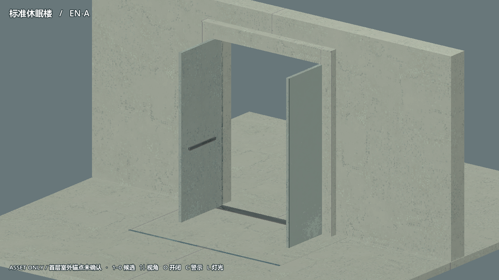
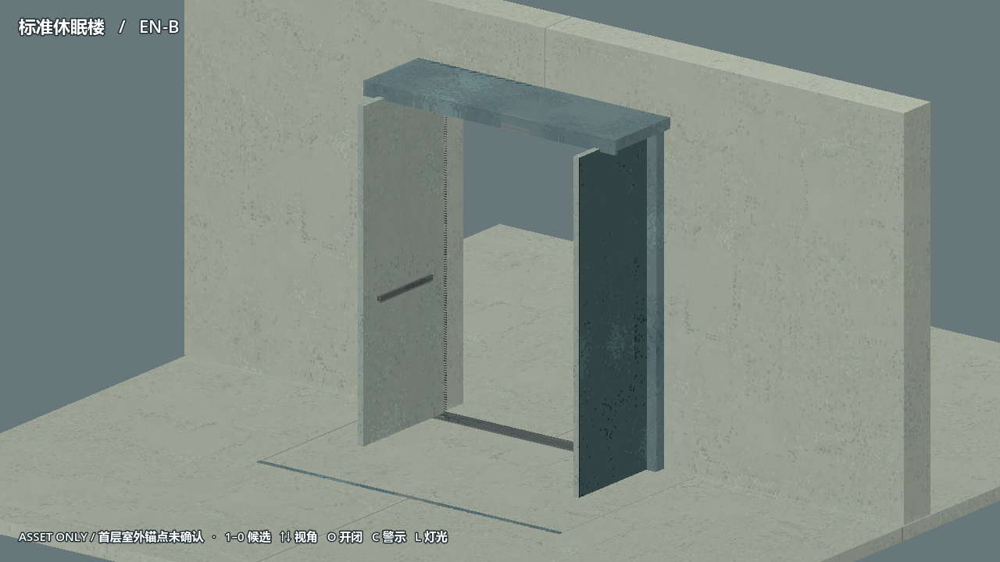
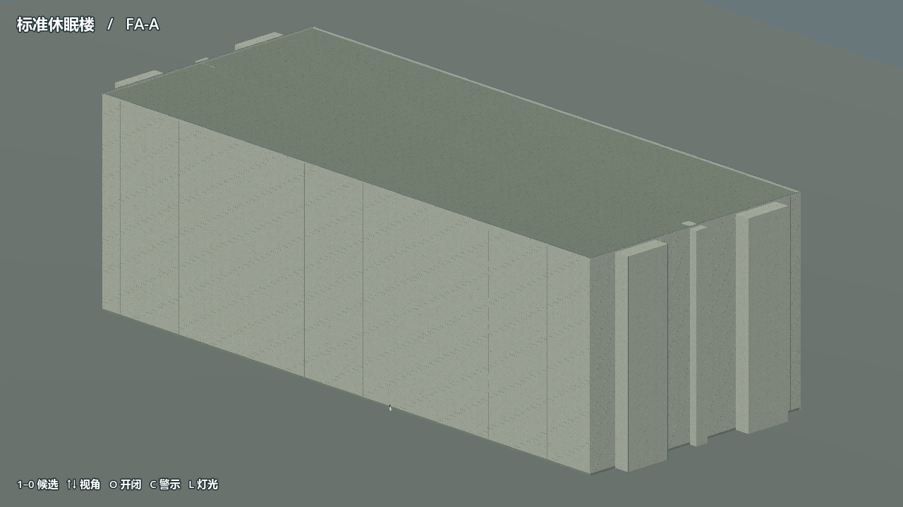
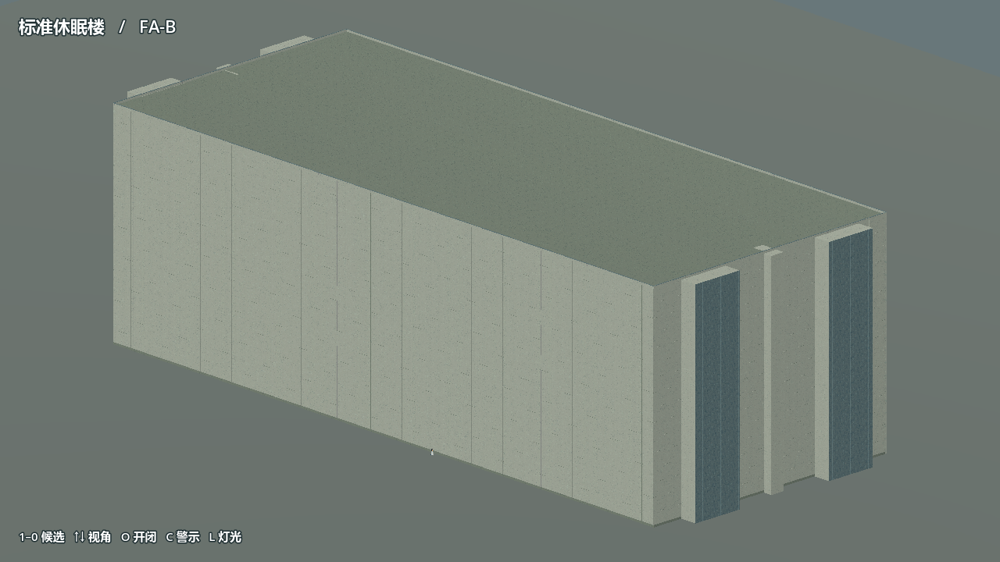

# 标准休眠楼｜10 款建筑候选对比

以下均为独立 Godot 场景的 1280×720 实拍。左列为 A 组合，右列为 B 组合；各组可独立选择。点图看原尺寸。

## HR 扶手

| HR-A · 连续圆管＋细竖杆 | HR-B · 折板＋独立握持轨 |
|---|---|
|  |  |
| [感应增亮](evidence/godot/hr-a_occupied.png) · [保底光](evidence/godot/hr-a_baseline.png) · [下段](evidence/godot/hr-a_side.png) · [上段](evidence/godot/hr-a_upper.png) · [中性检查](evidence/godot/hr-a_neutral.png) | [感应增亮](evidence/godot/hr-b_occupied.png) · [保底光](evidence/godot/hr-b_baseline.png) · [下段](evidence/godot/hr-b_side.png) · [上段](evidence/godot/hr-b_upper.png) · [中性检查](evidence/godot/hr-b_neutral.png) |

## FD 楼梯分区门

| FD-A · 等宽双扇 | FD-B · 65/35＋窄侧检修带 |
|---|---|
|  |  |
| [室内侧](evidence/godot/fd-a_rear.png) · [机械释放](evidence/godot/fd-a_release.png) · [打开 90°](evidence/godot/fd-a_open90.png) · [独立样段扫掠](evidence/godot/fd-a_sweep.png) | [室内侧](evidence/godot/fd-b_rear.png) · [机械释放](evidence/godot/fd-b_release.png) · [打开 90°](evidence/godot/fd-b_open90.png) · [独立样段扫掠](evidence/godot/fd-b_sweep.png) |

## EL 电梯入口

| EL-A · 两片中分 | EL-B · 三片侧收套叠 |
|---|---|
|  |  |
| [断电无警示](evidence/godot/el-a_closed.png) · [熄灭的操作件](evidence/godot/el-a_touch.png) · [穿过警示、停在门外](evidence/godot/el-a_pass.png) | [断电无警示](evidence/godot/el-b_closed.png) · [熄灭的操作件](evidence/godot/el-b_touch.png) · [穿过警示、停在门外](evidence/godot/el-b_pass.png) |

## EN 首层人员出口

| EN-A · 矿物门套，无雨棚 | EN-B · 折板门套，浅雨檐 |
|---|---|
|  |  |
| [室外闭合](evidence/godot/en-a_closed.png) · [室内侧](evidence/godot/en-a_rear.png) · [机械释放](evidence/godot/en-a_release.png) · [打开 90°](evidence/godot/en-a_open90.png) · [开扇扫掠](evidence/godot/en-a_sweep.png) | [室外闭合](evidence/godot/en-b_closed.png) · [室内侧](evidence/godot/en-b_rear.png) · [机械释放](evidence/godot/en-b_release.png) · [打开 90°](evidence/godot/en-b_open90.png) · [开扇扫掠](evidence/godot/en-b_sweep.png) |

## FA 建筑外壳

| FA-A · 水平矿物板带 | FA-B · 层高竖板＋金属节点 |
|---|---|
|  |  |
| [北](evidence/godot/fa-a_north.png) · [南](evidence/godot/fa-a_south.png) · [东](evidence/godot/fa-a_east.png) · [西](evidence/godot/fa-a_west.png) · [10 m 片段](evidence/godot/fa-a_detail10m.png) · [转角](evidence/godot/fa-a_corner.png) · [交通节点](evidence/godot/fa-a_node.png) · [首层](evidence/godot/fa-a_ground.png) · [屋顶](evidence/godot/fa-a_roof.png) · [B4–B1 技术图](evidence/godot/fa-a_b4.png) | [北](evidence/godot/fa-b_north.png) · [南](evidence/godot/fa-b_south.png) · [东](evidence/godot/fa-b_east.png) · [西](evidence/godot/fa-b_west.png) · [10 m 片段](evidence/godot/fa-b_detail10m.png) · [转角](evidence/godot/fa-b_corner.png) · [交通节点](evidence/godot/fa-b_node.png) · [首层](evidence/godot/fa-b_ground.png) · [屋顶](evidence/godot/fa-b_roof.png) · [B4–B1 技术图](evidence/godot/fa-b_b4.png) |

## ST-01 楼梯照明与适用范围

[双跑样段](evidence/godot/st-01_whole.png) · [28 秒 Godot 灯光动画](evidence/stair_motion_28s.gif)

- HR-A/B：扶手内缘净宽约 1.62 m，未达到冻结的 1.80 m；均是独立样段，暂不安装。
- FD-A/B：已核对独立样段的开合与碰撞，冻结楼梯平台上的整扇扫掠仍须在安装前验证。
- EL-A/B：均断电关闭；可穿过的 CAUTION 是显示层，门叶有碰撞。没有新增电梯功能。
- EN-A/B：均为 ASSET ONLY，首层外门没有确认的锚点。现有内核 D089–D096 是 2.4 m 旁通开口，缺门高及封闭门定义；K-01 保留这些通路，不在外墙或核心新装门。
- FA-A/B：共用冻结体量，地上 16 层＋地下 4 层。天气和外部照明是临时审图条件。独立场景使用实时光；正式光照图未重烘。

## 原生贴图与工程

[室内 Blender](model/interior_accessories.blend) · [立面 Blender](model/facade_assembly_v1.blend) · [制作与验证说明](README.md) · [GLB](../../../../assets/art/cryo_building_review_v1/models/)

| 材料 | 原始 PixelLab | 原生 PNG | Nearest 4× 无光裁片 | Aseprite |
|---|---|---|---|---|
| M01 · 728×232 | 沿用 | [PNG](../../../../assets/art/cryo_building_review_v1/textures/M01.png) | [4×](evidence/materials/M01_nearest4.png) | 沿用 |
| M02 · 256×192 | 沿用 | [PNG](../../../../assets/art/cryo_building_review_v1/textures/M02.png) | [4×](evidence/materials/M02_nearest4.png) | 沿用 |
| M03 · 192×256 | 沿用 | [PNG](../../../../assets/art/cryo_building_review_v1/textures/M03.png) | [4×](evidence/materials/M03_nearest4.png) | 沿用 |
| M08 · 4×184 | 沿用 | [PNG](../../../../assets/art/cryo_building_review_v1/textures/M08.png) | [4×](evidence/materials/M08_nearest4.png) | 沿用 |
| M09 · 256×5 | 沿用 | [PNG](../../../../assets/art/cryo_building_review_v1/textures/M09.png) | [4×](evidence/materials/M09_nearest4.png) | 沿用 |
| M10 · 192×16 | 沿用 | [PNG](../../../../assets/art/cryo_building_review_v1/textures/M10.png) | [4×](evidence/materials/M10_nearest4.png) | 沿用 |
| M04 · 256×64 | [原图](raw/M04.png) | [PNG](../../../../assets/art/cryo_building_review_v1/textures/M04.png) | [4×](evidence/materials/M04_nearest4.png) | [分层](editable/M04.aseprite) |
| M05-L · 256×256 | [原图](raw/M05-L-R1.png) | [PNG](../../../../assets/art/cryo_building_review_v1/textures/M05-L.png) | [4×](evidence/materials/M05-L_nearest4.png) | [分层](editable/M05-L.aseprite) |
| M05-D · 256×256 | [原图](raw/M05-D-R1.png) | [PNG](../../../../assets/art/cryo_building_review_v1/textures/M05-D.png) | [4×](evidence/materials/M05-D_nearest4.png) | [分层](editable/M05-D.aseprite) |
| M07 · 256×256 | [原图](raw/M07-R1.png) | [PNG](../../../../assets/art/cryo_building_review_v1/textures/M07.png) | [4×](evidence/materials/M07_nearest4.png) | [分层](editable/M07.aseprite) |
| M06-01 · 256×256 | [原图](raw/M06-01-R1.png) | [PNG](../../../../assets/art/cryo_building_review_v1/textures/M06-01.png) | [4×](evidence/materials/M06-01_nearest4.png) | [分层](editable/M06-01.aseprite) |
| M06-02 · 256×256 | [原图](raw/M06-02-R1.png) | [PNG](../../../../assets/art/cryo_building_review_v1/textures/M06-02.png) | [4×](evidence/materials/M06-02_nearest4.png) | [分层](editable/M06-02.aseprite) |
| M06-03 · 256×256 | [原图](raw/M06-03-R1.png) | [PNG](../../../../assets/art/cryo_building_review_v1/textures/M06-03.png) | [4×](evidence/materials/M06-03_nearest4.png) | [分层](editable/M06-03.aseprite) |
| M06-J · 256×256 | [原图](raw/M06-J-R1.png) | [PNG](../../../../assets/art/cryo_building_review_v1/textures/M06-J.png) | [4×](evidence/materials/M06-J_nearest4.png) | [分层](editable/M06-J.aseprite) |
| M06-R · 256×256 | [原图](raw/M06-R-R1.png) | [PNG](../../../../assets/art/cryo_building_review_v1/textures/M06-R.png) | [4×](evidence/materials/M06-R_nearest4.png) | [分层](editable/M06-R.aseprite) |
| FACE_FD_A · 144×192 | [原图](raw/FD-A.png) | [PNG](../../../../assets/art/cryo_building_review_v1/textures/FACE_FD_A.png) | [4×](evidence/materials/FACE_FD_A_nearest4.png) | [分层](editable/FACE_FD_A.aseprite) |
| FACE_FD_B · 144×192 | [原图](raw/FD-B.png) | [PNG](../../../../assets/art/cryo_building_review_v1/textures/FACE_FD_B.png) | [4×](evidence/materials/FACE_FD_B_nearest4.png) | [分层](editable/FACE_FD_B.aseprite) |
| FACE_EL_A · 112×192 | [原图](raw/EL-A.png) | [PNG](../../../../assets/art/cryo_building_review_v1/textures/FACE_EL_A.png) | [4×](evidence/materials/FACE_EL_A_nearest4.png) | [分层](editable/FACE_EL_A.aseprite) |
| FACE_EL_B · 112×192 | [原图](raw/EL-B.png) | [PNG](../../../../assets/art/cryo_building_review_v1/textures/FACE_EL_B.png) | [4×](evidence/materials/FACE_EL_B_nearest4.png) | [分层](editable/FACE_EL_B.aseprite) |
| FACE_EN_A · 144×192 | [原图](raw/EN-A.png) | [PNG](../../../../assets/art/cryo_building_review_v1/textures/FACE_EN_A.png) | [4×](evidence/materials/FACE_EN_A_nearest4.png) | [分层](editable/FACE_EN_A.aseprite) |
| FACE_EN_B · 144×192 | [原图](raw/EN-B.png) | [PNG](../../../../assets/art/cryo_building_review_v1/textures/FACE_EN_B.png) | [4×](evidence/materials/FACE_EN_B_nearest4.png) | [分层](editable/FACE_EN_B.aseprite) |
