# 一体化护栏灰模对比

三款使用同一灰色和光照，点图查看 1280×720 原图。

| A · 原杆件 | B · 原折板 | C · 一体化握持槽 |
|---|---|---|
| [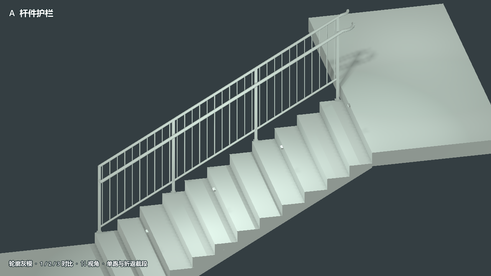](evidence/a_overview.png) | [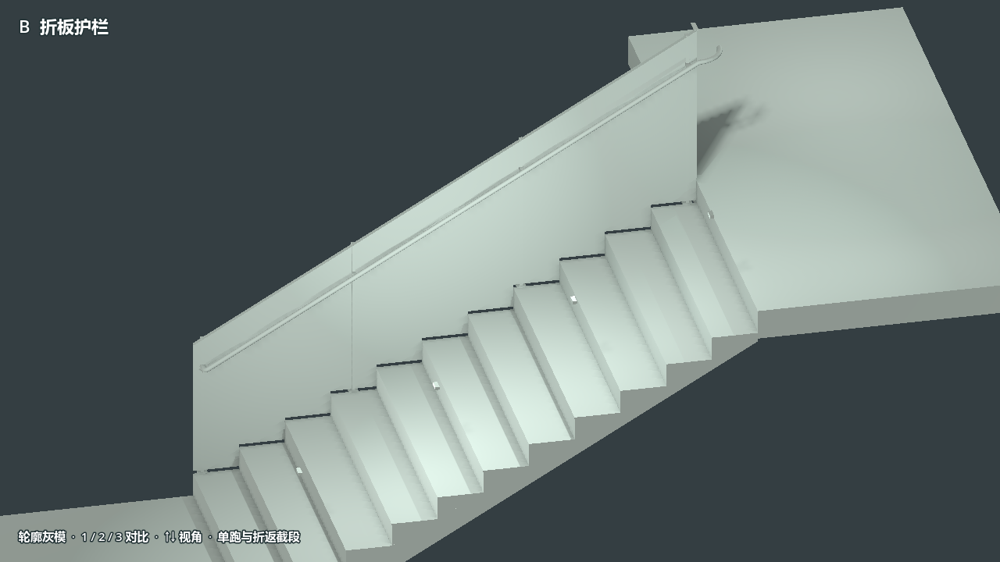](evidence/b_overview.png) | [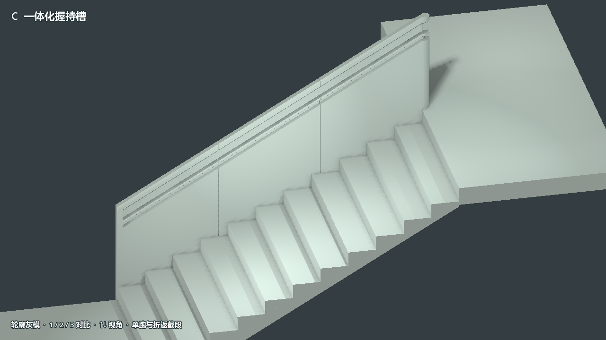](evidence/c_overview.png) |

## 握持位置

| A | B | C |
|---|---|---|
| [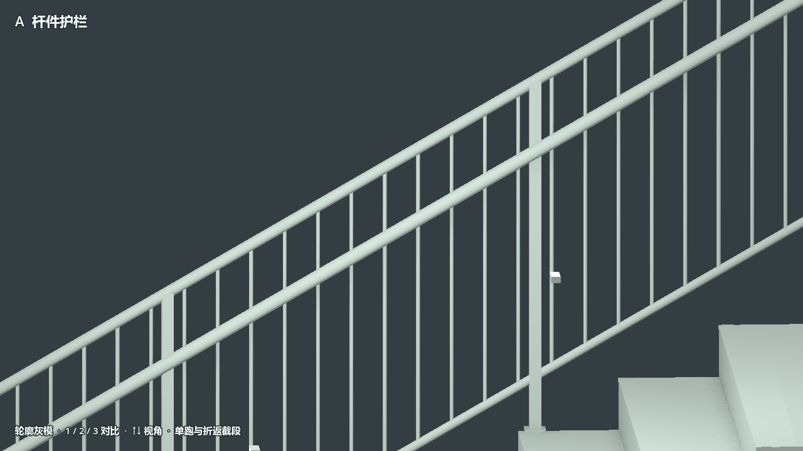](evidence/a_grip.png) | [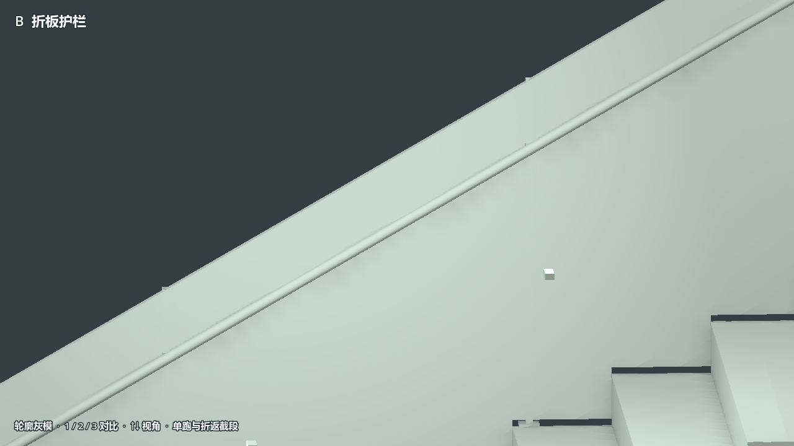](evidence/b_grip.png) | [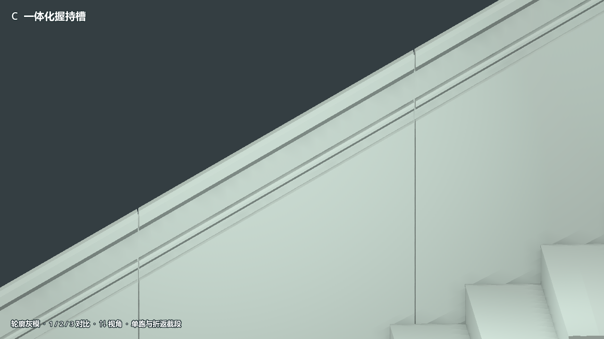](evidence/c_grip.png) |

## 折返截段

| A | B | C |
|---|---|---|
| [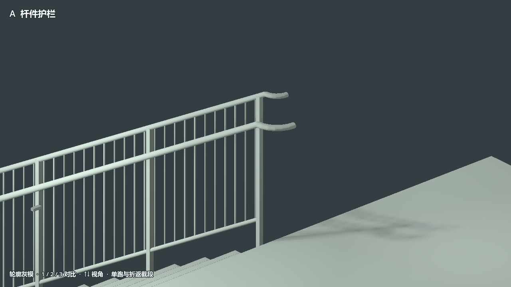](evidence/a_turn.png) | [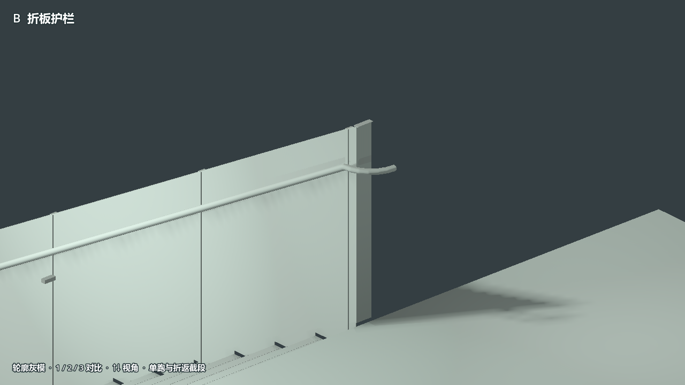](evidence/b_turn.png) | [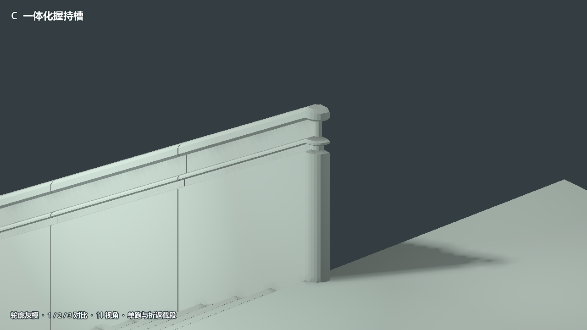](evidence/c_turn.png) |

## 游戏方向与人物尺度

| A | B | C |
|---|---|---|
| [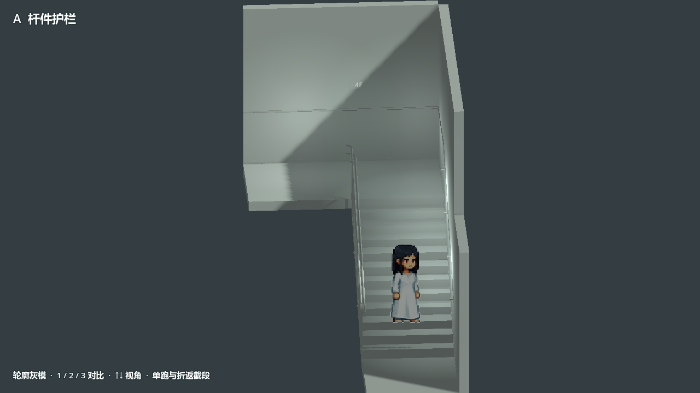](evidence/a_hero.png) |  | [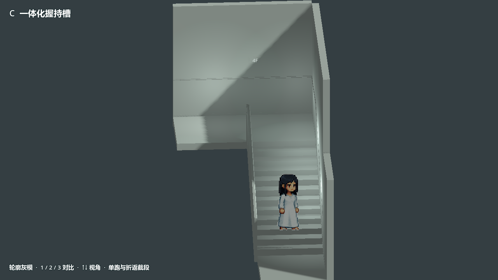](evidence/c_hero.png) |

C 是形体候选。完整净宽、墙侧握轨和双跑安装仍待整合检查。

[Blender 工程](model/handrail_integrated_v1.blend) · [尺寸与说明](README.md)
