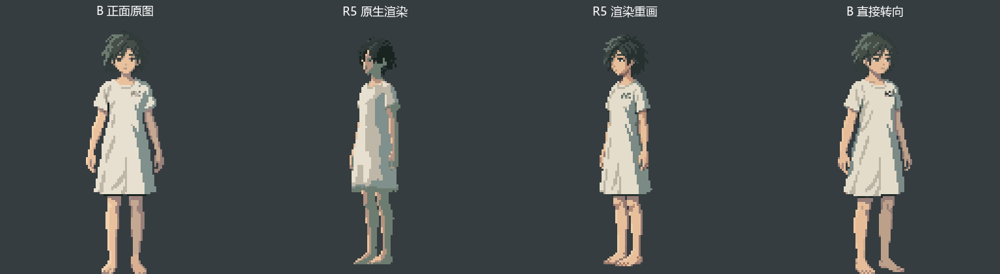
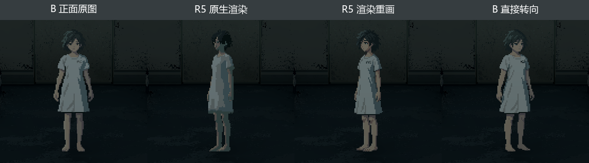

# 主角 45° 站立精灵路线对照

四列均使用 128×128 原画布。可见宽×高依次为 B 40×125、R5 26×117、重画 27×119、直接转向 38×125。重画保住向画面左的朝向和窄身轮廓，补出了面部、发梢和衣褶。直接转向保留了较宽的衣身和原脸，但偏向画面右，双肩仍接近正面。两张都是下载原件，未镜像、补画或配准。

## 生成记录

PixelLab 网页 Edit Image Pro，Pro 模式，两次均开启 Remove background，输出 128×128。每条只提交一次，每次按钮标价 10 generations，合计 20。账户页在一项仍在生成时记录 196 / 2,000，两项结束后为 206 / 2,000。本轮开始前未取账户读数。

1. [R5 输入](../protagonist_sprite_r5_native_r1/sprite_45.png)＋[B 风格参考](../protagonist_front_c_raw_v2/B_original.png) → [重画原件](redraw.png)。提示词：Redraw the first sprite in the pixel style of the reference. Keep its 45-degree standing pose, facing, proportions and size. Match the reference hair, eyes and ivory gown.
2. [B 输入](../protagonist_front_c_raw_v2/B_original.png)，参考槽为空 → [直接转向原件](direct.png)。提示词：Turn this standing character 45 degrees toward screen left, front three-quarter view. Keep her original pixel style, proportions, sleepy eyes, short hair and ivory gown.

## 实机

Godot 4.6.2 Compatibility，Room 1 原有纸片人材质、受光、站位和 50° 镜头。按可见高度对齐脚底和世界身高，截图为 1280×720。四张全图：[B](room_B.png)、[R5](room_render.png)、[重画](room_redraw.png)、[直接转向](room_direct.png)。相对于 B，三张差异均位于人物区域 (602,263) 至 (678,495)，按左闭右开计。原图三倍排列保持原生像素尺寸，游戏截图裁切保留屏幕像素。
