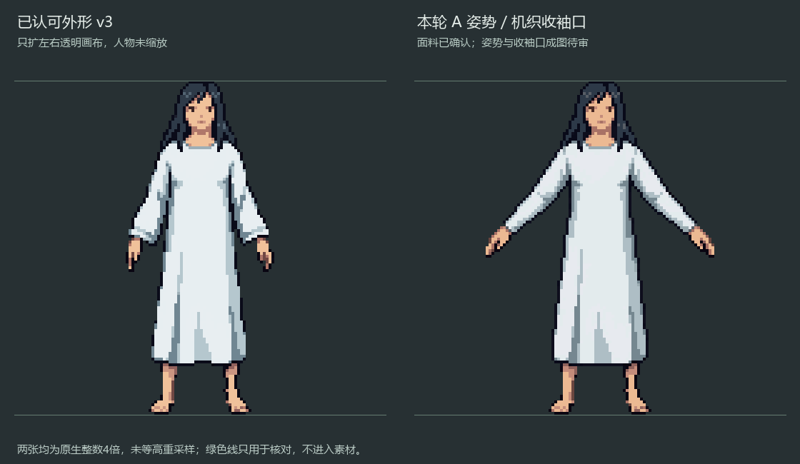
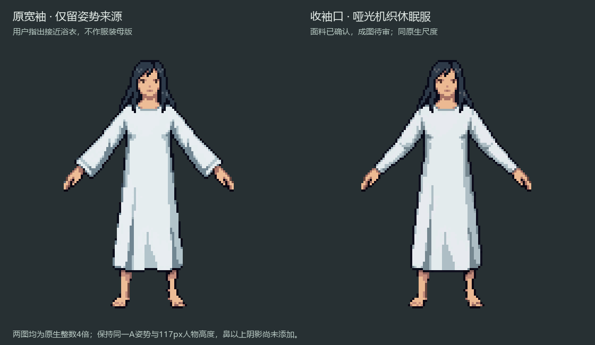

# 主角正面 A 姿势参考 v4

2026-11-17，**正面A姿势／收袖口候选，成图待审；休眠服面料已确认。**用户沿用v3外形与像素处理，并提出“鼻子以上涂上阴影”、准备T姿势／3D，要求不要重复上次失败。本轮仅生成一张正面A姿势参考；没有补侧背面、制作或生成新3D、试穿、绑定、换贴图或替换Godot角色。

[对比页](preview.html) · [原生PNG](front_apose.png) · [分层Aseprite](editable/front_apose.aseprite) · [请求与额度](source/generation_record.json)

两图均以每个原生像素整数4倍显示，未按人物高度重新缩放。绿色头顶／脚底线只存在于审图排版，不进入素材。

**本轮随后反馈与确认：**用户认为宽袖白袍加白腰带像浴衣，随后明确选择“细密哑光、略挺的涤纶混纺机织布”，配收窄袖口。本轮据此增加一次PixelLab定向编辑，保留A姿势，收窄手腕开口、让袖子渐收；保留闭合圆领、一体套头、不对襟、不加腰带。低分辨率主要靠轮廓与折痕表达织物，不增加细密织纹噪声。具体纤维比例、织物寿命／低温性能没有资料，不编造成事实。宽袖版只留姿势来源，不作为最终服装母版。面料方向已定，收袖口成图待审后再补侧背面及进入3D。

## 为什么先选 A 姿势

这里的A姿势为双臂斜向外下，目标与竖直躯干约40～45°。对这件宽长袖白袍，制作判断是：让腋下、袖子和手部之间出现清楚间隙，同时保留较自然的肩袖形状，适合作为这一轮造型参考。不是认为T姿势不能用，或A姿势自动解决衣物结构。

Tripo当前官方说明同时建议T或A姿势，并要求查看关节权重；它也明确肩部自动权重可能仍需在DCC修改。[官方 Rigging & Animation](https://www.tripo3d.ai/product-doc/module-post-processing/rigging-animation)（2026-11-17核查）。这不证明国内站任一具体自动绑定模式都具有相同能力；正式使用时核对所选入口，必要时把身体、衣物、头发统一到同一T姿势，不能只改其中一件。

用户要求的鼻子以上阴影登记为**后续局部像素贴图修改**，本张不额外画成黑面罩，也不据此给3D增加眼眶、复杂鼻唇或表情几何。

## 实际结果与观察边界

- 两次PixelLab Pro请求均为128×128、16可见RGB色、二值透明；人物可见范围`(24,6)-(104,123)`，高117px，与v3一致。只扩左右空间，没有把人物缩小后重画成更细的颗粒。第二次衣料修改保持同一姿势与纵向边界。
- 实际看图：成人小头、头顶脚底、袍长与腿长延续v3；双臂展开后腋下有负空间，手在收窄的袖口以外，正面可理解肩臂连接；没有横向T字、尖肩、独立袖片或明显多肢。目标角度是提示词约束，不宣称像素图中每个关节恰好达到40～45°。
- PixelLab并非逐像素保护编辑：脸、头发和局部色值也有细小重绘。`source/validation.json`的头部区域RGBA差异是连带变化记录，不能说除了手臂以外每个像素都没变。外观基准仍是v3，用户审看此姿势不等于批准全部连带细节。
- 只有正面，不能据此验证身体前后厚度、白袍真实袖口／领口／下摆开口、后脑／背部、手背／脚跟或可动画拓扑。
- v3游戏内95%高度选项未在本轮单独裁决；本图的117px是原生绘图高度，不是新设定的真实身高或3D UV密度。

## 来源与可编辑文件

- `source/approved_v3.png`为已认可外形的字节相同副本，源SHA-256：`35889c3e1cef6e2b29228822edd8021006b489328816d58e434f29ca65d540fb`。
- `source/apose_GUIDE.png`：把该96×128图原样放到128×128透明画布的x16处，无缩放、局部重画或姿势脚本变形。
- 官网Creator → Edit image → Pro，经Chrome扩展操作，共两次请求：第一次以`apose_GUIDE.png`调整姿势；用户确认面料后，第二次以第一次原图的字节相同副本`material_GUIDE.png`收袖口和调整织物处理。没有辅助第三方图片，没有上传Pixel Canals／武士零／SIGNALIS内容。提示词、[网站生成详情](source/creator_metadata.txt)、[结果截图](evidence/pixellab_result.jpg)均保留。
- 额度观察 **76→86→96／2000，两次共实扣20**，余1904，页面显示12月13日重置／续费。没有Tripo调用或其他额外付费操作。
- `raw/pose_only_wide_cuff.png`保留第一次宽袖原图，`raw/front.png`为第二次收袖口原图。最终`front_apose.png`包含Aseprite的一项局部修正：移除PixelLab新加的胸前横向灰影，避免读成额外拼接／胸下收束线。精修独立图层只在`x56–72,y41–44`中修改38个像素；用前一A姿势的平整布面作配准判据，使用当前已有主布色恢复，alpha不变，其余像素与收袖口原图完全相同。不是重新绘制服装主体或用程序生成纹理。
- Aseprite共五层：PixelLab收袖口原图、隐藏v3原尺度导图、隐藏修改前A姿势导图、胸前横影局部恢复层、空白未来上半脸阴影层。[局部修改记录](source/local_refinement.json)与[验证记录](source/validation.json)分别说明来源、范围与最终导出读回；不能把最终图称为未经修改的PixelLab原图。

## 这次3D如何避免重演已有失败

下面是后续开工与验收约束，**尚未完成**，也不是仅靠提示词就能保证的生成结果。

| 已有证据 | 本次具体约束 | 何时停止推进 |
|---|---|---|
| 旧脚本白袍肩部尖角、袖截面扁片，虽静态零自交仍被否决 | 对齐当前外形参考；先看统一灰模正／侧／背／斜视的肩袖体积，不重复旧脚本衣物重建 | 明显不自然时不进入权重阶段 |
| Tripo v3.1重新生成白袍有3个脱离碎片，领口与下摆有内部封挡；未检出真自交仍不可穿 | 在Blender副本中剖看内部，检查真实边界环、腋下连接、领袖下摆贯通、隐藏封盖与悬空碎片 | 不能只删黑方片、增加厚度或把探针报告当作已可穿 |
| 身体和衣物臂角不一致，原白袍自交与双层试穿失败 | 身体、白袍、头发分别保留可编辑网格，统一同一参考比例、关节中心与休止姿势；衣物是一层可维护主表面，领袖下摆有必要收边厚度，不复制整套内外壳堆叠 | 不把不同姿势的部件直接自动权重后拼接；生成不能保证分件时先检查实际网格 |
| 老头发细丝／窄条、僵硬杆状前发与壳状后发 | 只保留当前发型的大体块与少数发束，贴图承担内部发束；同时核对侧背轮廓，不能简化成头盔 | 外观不合格就停在静态形体审查 |
| 旧背面图出现正面手脚 | 后续正侧背保持同姿势、同身高和同服装；逐项查背面手背／拇指侧、跟腱／脚跟和脚趾遮挡 | 错误背面不能进入多视图生成，更不能用正面翻转冒充背面 |
| 静态检查或四边面标签不代表能动 | 外形／开口通过后才试穿，共用一套骨架；抬臂、弯肘、迈步检查腋下、袖口、下摆与身体穿插，保留动作证据 | 自动绑定成功不等于验收，失败不继续靠权重掩盖几何问题 |

失败来源可核查：[脚本单层重建已否决](../protagonist_robe_single_surface_v1/README.md)、[Tripo白袍v3.1实际检查](../protagonist_tripo_robe_h31_v1/README.md)、[主角制作简报](../../PROTAGONIST_LOW_POLY_BRIEF.md)。旧身体v2只作为可评估部件，不默认适合新参考的头身与风格；先匹配轮廓再决定复用。

顺序：本张正面姿势审看 → 同设计同姿势侧背面核对 → 分件几何初稿／统一灰模外形 → 开口与内部结构 → 试穿与关节动作 → UV／PixelLab像素贴图 → Godot实际镜头。每步都保留源文件和失败边界；不得把“出了模型”写成“模型可用”。

## 复现打包

`source/package_editable.py`通过Aseprite批处理包装现有像素和38px的已记录局部平整布面恢复；`source/build_preview.py`只验证和排版，不调用生成、不重画人物。保留原始图，不以审图参考线或放大图作为后续纹理输入。
