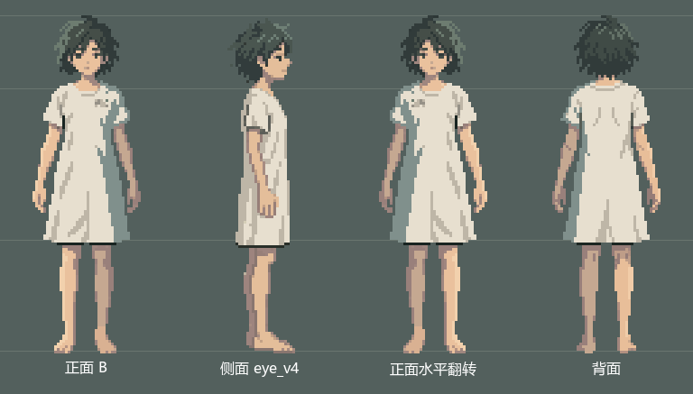
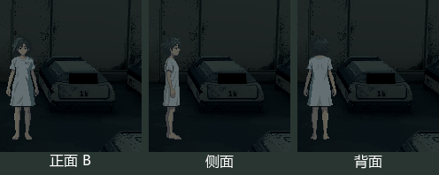

# 阶段一背面 · 定稿

[背面 128×128 PNG](back.png) · [Aseprite 分层母版](back.aseprite)。PixelLab Edit image Pro 的编辑底图是[正面 B 的完整水平翻转](raw/mirror.png)，参照为项目的 eye_v4/side.png。原正面仍作为第一栏。只生成一次，按钮标价 10 generations，未核对余额差。开启移除背景，Max colours 16。[提示词](raw/prompt.txt) · [原始输出](raw/master.png)。

## 同尺度核查

四栏均在原 128×128 网格上按整数 3 倍显示。以脚底为基线，侧面仅在审图向下平移 1 px。下表是基线对齐后的位置，y 从上往下，肩取衣袖外缘转入下斜处，为目测约值。

| 位置（原生 px） | 正面 B | 侧面 | 背面 | 最大差 |
|---|---:|---:|---:|---:|
| 头顶 | 3 | 4 | 3 | 1 |
| 肩部斜线转折 | 约 30 | 约 31 | 约 30 | 约 1 |
| 下摆最低衣缘 | 86 | 88 | 86 | 2 |
| 脚底 | 127 | 127 | 127 | 0 |

镜像正面的左右指尖在 y=75，分别占 x=47～48、79～80；背面同一行分别为 x=46～47、80～81。两只手各向外约 1 px，指尖高度吻合。脚底上方两行（y=125），镜像正面两脚占 x=53～59、69～75，背面为 x=53～59、68～74。左脚位置吻合，右脚向内 1 px。背面的脚跟比正面脚尖窄，保留了这个视角差异。

背面保留后脑短发体积、后颈发梢和肩胛处两道浅褶，衣背留白。Aseprite 仅在独立图层把衣料两种近白色并到 B 的亮色，并统一中间色、灰绿暗色；没有配准或移动肢体。Room 1 为实机截图静态合成，同脚底位置、受光系数、显示高度 117 px。

定稿修色：画面左侧手臂 130 px、腿 222 px，共 352 px 换为正面 B 的 #C5A891 和 #99807B，透明度逐像素一致。[正面翻转与背面](mirror_back.png)
