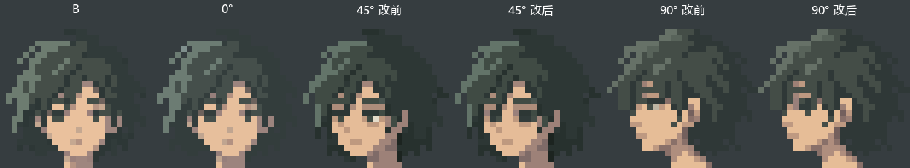
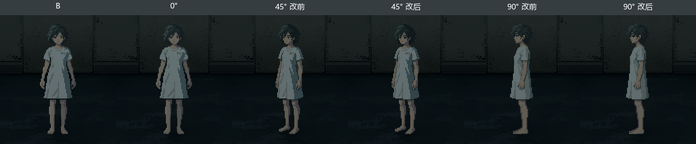

# 五方向站立精灵 · 眼睛局部修订

五方向身份和站姿已认可，本轮仅在 45° 和 90° 原分层源上新建眼睑层，颜色取自 B。45° 改 7 px，90° 改 9 px，侧眼的低点留在眼睛中段，前缘降低对比。原图与导出图透明度逐像素相同。Godot 修前修后差异仅位于眼周，45° 为 17×3 屏幕像素范围，90° 为 8×5。生成额度 0。

[45° 分层源](final_45.aseprite) · [90° 分层源](final_90.aseprite) · [45° 全画幅](room_45.png) · [90° 全画幅](room_90.png)
