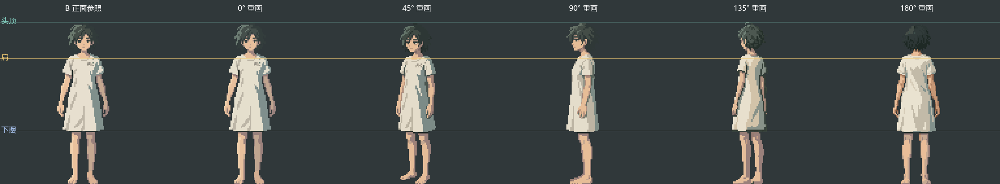
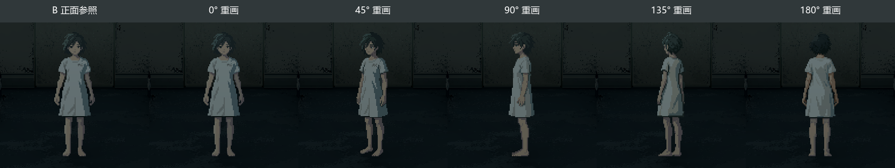

# 主角五方向站立静帧

## 可复现的输入与生成

R5 区域平涂模型搭配 A 三阶着色器。正交相机固定在 +X，光向保持在镜头左上方，只转动角色。双腿轻微分开并采用不对称偏移。五个方向的不透明高度均为 125 px，128×128 画布上的最后一个不透明像素位于 y=126。输入先按 B 的 17 色做最近色映射，保留无抗锯齿的像素边缘。见 [输入并排](inputs_Bpalette_compare.png)、[渲染脚本](render_inputs.gd)和[尺寸测量](input_metrics.json)。

PixelLab 网页 Edit Image Pro，Pro 模式，透明背景，参照均为 [B 正面原图](../protagonist_front_c_raw_v2/B_original.png)。下表中 input 是实际上传图，raw 是下载原件。提示词共用同一段，仅首句标出当前角度和朝向。

> View {angle}, {view}. Redraw image one at its exact angle, pose and size in the reference pixel style. Same young adult, smooth short hair, sleepy dark eyes when visible, thin ivory gown, warm skin shadows. Screen-left light.

| 角度 | view | 输入 | 生成原件 | Aseprite 分层源 | 实机 |
|---|---|---|---|---|---|
| 0° | front | [input](input_0_Bpalette.png) | [raw](raw_0.png) | [分层源](final_0.aseprite) · [PNG](final_0.png) | [完整截图](room_0.png) |
| 45° | front three-quarter facing left | [input](input_45_Bpalette.png) | [raw](raw_45.png) | [分层源](final_45.aseprite) · [PNG](final_45.png) | [完整截图](room_45.png) |
| 90° | left-facing profile | [input](input_90_Bpalette.png) | [raw](raw_90.png) | [分层源](final_90.aseprite) · [PNG](final_90.png) | [完整截图](room_90.png) |
| 135° | rear three-quarter facing left | [input](input_135_Bpalette.png) | [raw](raw_135.png) | [分层源](final_135.aseprite) · [PNG](final_135.png) | [完整截图](room_135.png) |
| 180° | back | [input](input_180_Bpalette.png) | [raw](raw_180.png) | [分层源](final_180.aseprite) · [PNG](final_180.png) | [完整截图](room_180.png) |

## 实机与额度

PixelLab 共完成 5 个请求，每个按钮标价 10 generations，按页面标价合计 50。五向均使用第一次输出。Room 1 通过原有纸片人材质显示，同一脚底位置、同一身高和既有受控镜头，各角度的完整截图见上表。三倍并排只对齐脚底并作整数最近邻放大，保留各张生成的实际身高差。镜像得到的另外三个方向会连同受光一起翻转，本轮按约定留待后续。

## 一致性自查

| 项目 | 五向并排与实机观察 |
|---|---|
| 眼睛和神情 | 0° 最接近 B。45° 近眼略更清楚，90° 可见深色上睑，侧脸仍稍比正面清醒。两个背向按可见角度处理。 |
| 年龄 | 小眼、头身比例和短袖长度贯穿转身，正面和前斜面保有 B 的年轻成人观感。背面主要靠头身与肩宽辨认。 |
| 头发 | 五向均为短发，90° 和 135° 的后脑有体积。135° 发束纹理比正面密，180° 的发块较整。 |
| 衣服 | 暖白短袖、膝长、下摆微张。胸口标记在正面与前斜面是小像素簇，实机尺寸无法逐字辨读。侧面衣身从胸口向下垂。 |
| 四肢 | 正面双脚分开，斜面开始前后重叠；90° 双腿投影几乎重合，仍有小腿肚和脚跟。135° 再度看到双脚。 |
| 皮肤暗部 | 五个方向在独立 Aseprite 图层修了裸腿和脚的阴影，135° 的灰绿块和 180° 的铜色块已归回 B 的肤色。脸、手臂仍保留 PixelLab 的细微色差。 |

0°、45°、90°、135°、180° 的人物可见高度依次为 125、124、124、125、125 px。衣身中段取中央区域逐行比较，两半的平均亮度五向均为画面左侧更高。180° 另在左上发冠补亮 22 px。实机六张截图尺寸均为 1280×720。各方向与 B 截图的差异都局限于人物区域。修正前后透明度逐像素一致，见 [局部修改记录](touchups.txt) 和 [实测](final_metrics.json)。
