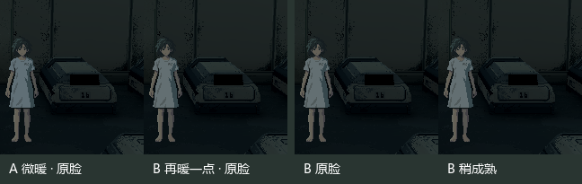
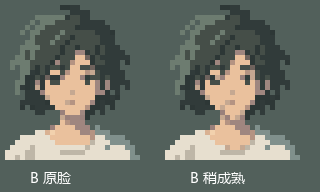

# 概念 C 原图修色与年轻成年人脸部小样

前两格是原脸配 A 微暖与 B 再暖一点，后两格统一 B 色看脸。原生 128×128，全身可见 40×125。画面复用了此前 Room 1 截图局部和受光系数，预览等比显示为 117 px 高。同尺寸下脸部差异很小，两个工程默认显示原脸。

[PixelLab 原图](../protagonist_front_color_c_v1/raw/master.png)直接作为底层。右侧衣服黑色替换为冷灰绿 #80908C，独立衣色层沿用 A／B 暖白。两个工程都保留可切换的年轻成年人脸部层，缩短眼部暗点，收尖并下延下巴，在领口补一行颈部肤色。所有 PNG 透明度逐像素与原图一致，头顶、脚底及各关节沿用原图。本轮新生成次数为零。

[微暖 A 工程](A.aseprite) · [再暖一点 B 工程](B.aseprite) · [A 原脸](A_original.png) · [A 稍成熟](A_adult.png) · [B 原脸](B_original.png) · [B 稍成熟](B_adult.png)
