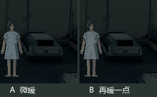
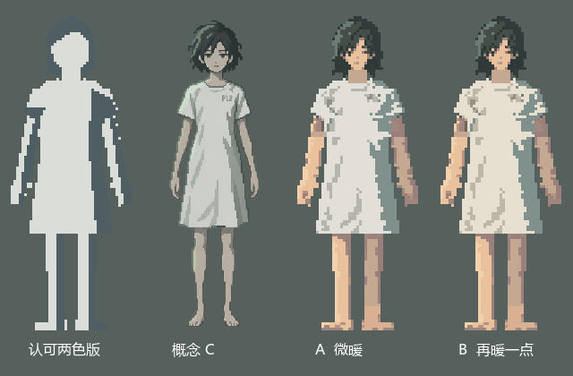

# 概念 C 正面正式上色 · 两档衣料暖白待选

| 版本 | 原生 128×128 | Aseprite 分层母版 |
|---|---|---|
| A 微暖 | [PNG](front_A.png) | [索引色母版](front_A.aseprite) |
| B 再暖一点 | [PNG](front_B.png) | [索引色母版](front_B.aseprite) |

A 的主亮面为 #E1DFD7，B 为 #E7DFCF。两版共享头发、肤色、编号位置、衣褶和全部透明度；衣料亮面与中间调共 1239 像素存在 RGB 差异。最深的衣料暗面均借灰绿色。只有胸前很小的一簇灰色暗示 P12。

PixelLab 网页 Creator → Edit image Pro，128×128，移除背景开启，最大颜色数 16。输入为项目已认可的 [L2 两色图](../protagonist_l2_front_twotone_v1/front_twotone.png)，参照为[概念 C 的缩小裁片](source/C_ref.png)。实际提交一次，按钮标价 10 generations，未核对账户前后余额。此前本机 API 入口因插件配置缺失在发请求前退出。

实际提示词：Colour the first sprite like reference C. Short dark hair, simple calm eyes, warm light skin, white short-sleeve medical gown with tiny P12 chest print, bare feet. Strictly preserve the first image silhouette and pose.

[PixelLab 原图](raw/master.png)人物为 40×125，头顶偏高、脚底偏低，手臂也更贴身。与认可剪影直接逐像素比对有 665 个透明度差异。用原图的内部像素按高度和横向连续区域配准到 L2，重排局部脸、后发、颈部与袖口边界；右侧布面最深色改为冷灰，避免读成黑色拼接。代价是比概念 C 更简化的脸和较直的臂脚。最终 45×117、剪影差异 0 px。本轮保留认可的手臂，当前宽度在舱旁可分辨手和衣身。

Aseprite 两份均为原生索引色，两层分别为人物与衣服。调色板和索引图随附；source/register.py 与 export.lua 可复现配准和导出。source/review.py 核对两份 PNG 的轮廓及全部差异位置，复用概念审图的同一截图、同一坐标和逐通道亮度换算。场景图为实机背景静态合成，未替换 Godot 角色。等待用户选定暖度。
