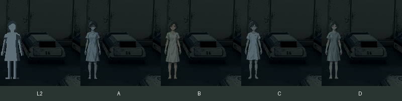
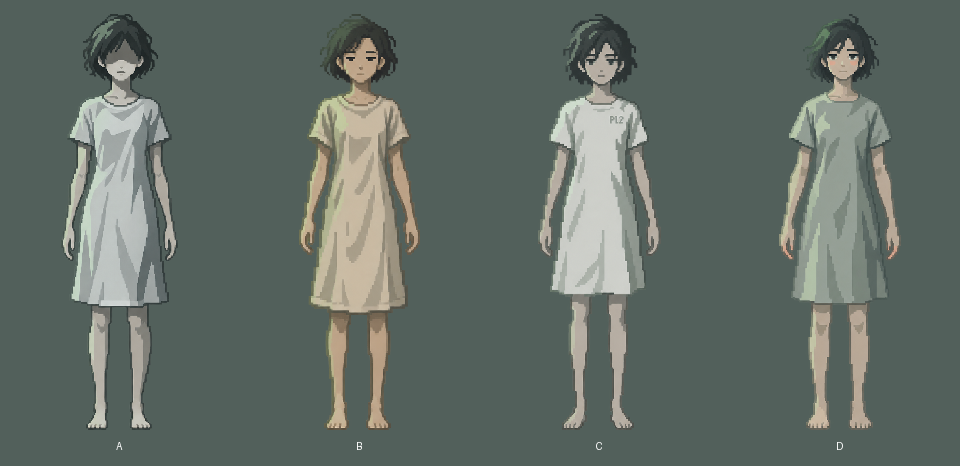

# 阶段一正面概念方向 · 11/24 待选

| 原图 | 想表达的感觉 | 生成偏差与小尺寸观察 |
|---|---|---|
| [A 冷白](A.png) | 冷白薄布和一整块眼部阴影表现刚醒来的迟钝。 | 手臂更贴身，脚趾和衣褶比 L2 细；缩小后眼部阴影仍明显，有些阴森。 |
| [B 米白](B.png) | 洗旧的暖米白让人先看到穿着衣服的普通人。 | 下摆较低，肩袖和领口偏厚；小尺寸下与暗绿舱体的冷暖区分最清楚。 |
| [C 舱号](C.png) | 中性浅色和小小的 P12 印字表现统一配发的休眠服。 | 发顶有额外翘发，分指明显；117 px 下印字只剩灰点，不能指望玩家读出编号。 |
| [D 灰绿](D.png) | 布料吃进应急灯的灰绿色，只靠脸和手的一点暖色留下人的气息。 | 眼睛和脸颊画得较具体，手脚偏细；最贴近环境，远看时面部暖意较弱。 |

四张均由 Codex 内置生图使用项目自有的 L2 正面两色 PNG 生成。横向等比缩到 117 px 高，认可版最大宽度 45 px，A 至 D 分别为 33、34、35、34 px。四张手臂都比原稿贴身，不能据此收窄成品剪影。脸部处理、印字与配色留待选定。

环境对照使用项目已有的 [Godot 截图](../protagonist_simplification_l123/evidence/game/game_L2_front.png)，取舱旁同一区域，以最近邻恢复至一半分辨率。每张脚底对齐，使用同一组逐通道增益，以原截图人物受光亮面 RGB 93/110/119 对应导图亮面 218/221/216。此为真实游戏背景上的静态合成，受光近似，未测动态光照。原生对照 800×202，概念拼图 960×466；可用 build_review.py 重建。正式外形继续以已认可 L2 为准。

生成要求为同一正面站姿、短发、短袖及膝、赤脚、简洁像素块和左上方暗绿环境光，四次分别指定冷白与眼部阴影、洗旧米白与最少五官、中性白与胸前 P12、灰绿布料与脸手暖光。未调用 PixelLab 或 Tripo。
