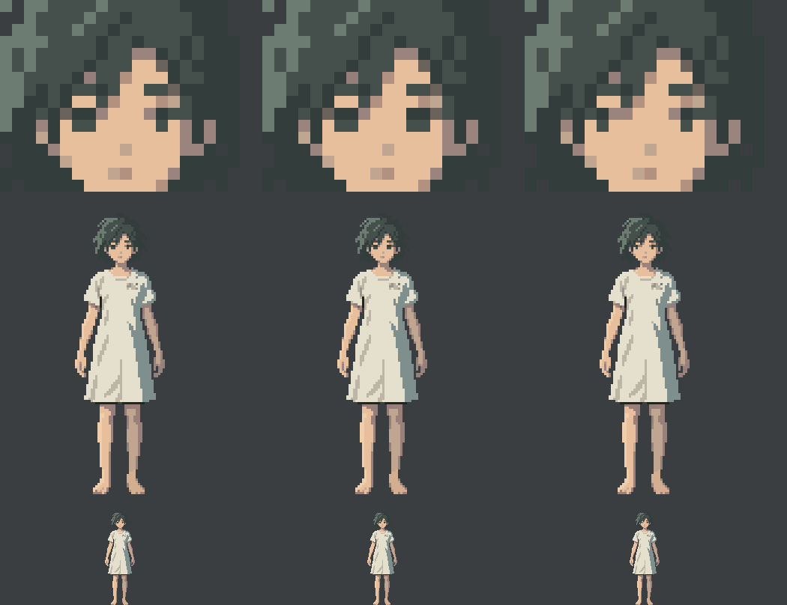

# 0° 正面大小眼修正

0° 站立帧的脸部像素与 [B 正面原图](../protagonist_front_c_raw_v2/B_original.png)位置完全一致（只差调色板映射），大小眼来自 B 本身。眉线 y15 和两眼左右间距对称，差别只在眼睛本体：画面左眼 y17 为 3 px、y18 为 2 px，画面右眼 y17 为 2 px（另混一格皮肤暗部）、y18 为 1 px。

11/25 用户选 **A**：以脸中线 x=63.5 为轴，把左眼 y17–18 的三列（x59–61）镜像到右眼（x66–68）。共改 3 px，透明度不变：

| 坐标 | 原色 | 新色 |
|---|---|---|
| (66,17) | #9C847E | #333D3C |
| (68,17) | #454F4B | #6C625C |
| (66,18) | #E7BF9C | #454F4B |

[final_0.png](final_0.png) 是 0° 帧现行版本，取代 [五向 r1 的 final_0.png](../protagonist_five_idle_r1/final_0.png)。在学校电脑用 .NET 逐像素改出，没有 Aseprite，r1 的 `final_0.aseprite` 还没加修正图层，之后要用上表补一个独立图层。B 原图未改。PixelLab 调用 0 次。
