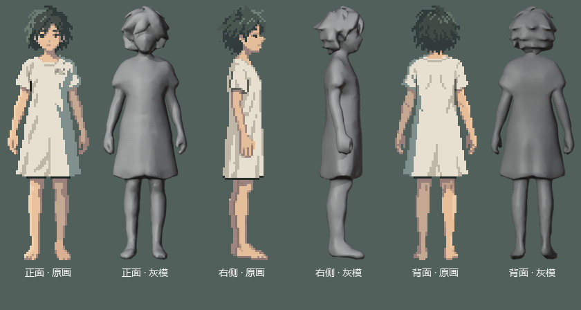

# 主角灰模 R2 · 平涂输入试做

[原始 GLB](original.glb) · [剪影叠比](overlay.png) · [斜 45°](oblique.png) · [仰视](underside.png) · [Room 1 实机](room.png) · [测量](metrics.json)

国内版 Tripo Studio H3.1：[任务](https://studio.tripo3d.com/workspace/generate/30aea425-cb1d-4dcf-8436-225813fc9099)。[建模平涂](../protagonist_model_flats_v1/README.md)按前、人物右侧、后上传，左侧槽空。标准精度，关闭贴图、8K 与分部件，三角面上限设为 8000。生成一次，1515 → 1500 积分。相较 R1，本轮同时改变输入图与面数，结果不能单归因于其中一项。

原模 3890 顶点、7784 三角面，一个连通体，无独立碎片，未检出开放边或非流形边。正、右、背正交各与对应的像素定稿对齐脚底并等高比较。衣面不再长出上一轮的凸片，小腿轮廓连续。侧面小腿肚、衣长及手腕与衣侧的空隙保留。袖肩偏圆，脸为简化面块，刘海厚，后脑发层较规整。头发与身体一体；领口、袖口缺少清晰开口，下摆与腿连在一起，仰视可见封底。按上轮相同高度取样，含袖肩宽 0.2660、胸部侧厚 0.1376（身高归一为 1），比值约 0.52，低于参考约 0.6。叠比和斜视最值得看头发、袖肩和手。

Room 1 截图取自 Godot 4.6.2 冻结场景，沿用上轮机位与 1.4025 米显示高度，角色在暗处，主要用于判断体态和尺度。脚本仅在运行时替换纸片。本轮建议保留整人灰模，在 Blender 局部整理头发、袖肩和衣口，换装分件待确认。
