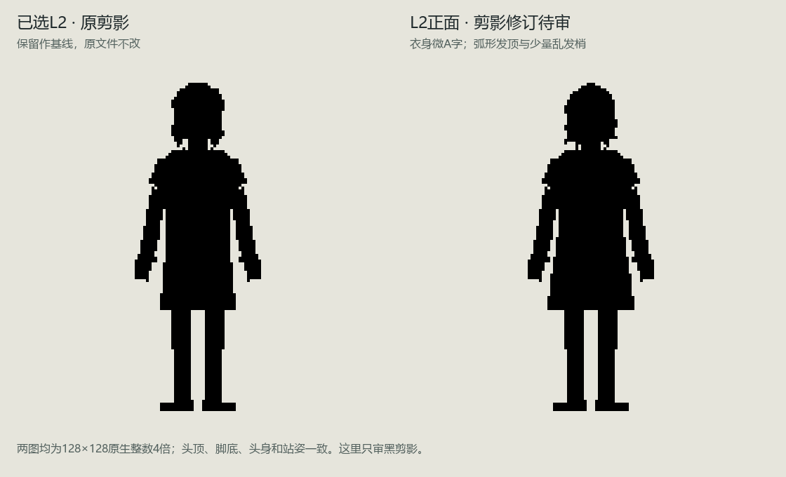

# L2 阶段一正面剪影｜待审

依据 [重设计简报第 4 节](../../PROTAGONIST_REDESIGN_BRIEF.md#4-选定档位之后的顺序)，以用户已选的 [L2](../protagonist_simplification_l123/README.md) 为基础，只修改正面剪影。**本次尚未获用户认可，不是已冻结定稿。**

[打开并排审图](preview.html) · [黑剪影 PNG](front_silhouette.png) · [可编辑 Aseprite](editable/front_silhouette.aseprite)

## 本次改动

- 衣身从腰部向下缓慢展开，下摆略呈 A 字；下摆两侧各增加 2 个原生像素，长度不变。
- 发顶以阶梯弧线代替较平的顶端；发尾略不齐，维持原短发长度与头部外接宽度。
- 头身、肩臂、手脚与站姿沿用 L2。没有重画脸、添加身份标记或改变材质。

| 正面实测 | 已选 L2 | 本轮剪影 |
|---|---:|---:|
| 原生画布 | 128×128 | 128×128 |
| 可见人物高度 | 117 px | 117 px |
| 头部高度／头身 | 20 px／5.85（约 6） | 同左 |
| 衣身腰宽（y=55） | 23 px | 23 px |
| 下摆宽（y=86） | 27 px | 31 px |
| 发顶最高行宽度 | 7 px | 3 px |

只有头发和衣身轮廓发生变化，共 124 个剪影像素。这里的宽度是正面原生像素实测，不是侧厚验收；侧面尚未制作。

## 源文件与验证

`editable/front_silhouette.aseprite` 包含衣身、头发、未变的身体／四肢三个可见层，以及原 L2、旧衣身、旧头发三个隐藏参照层。原 L2 文件保持不变。

`source/build_silhouette.py` 从已选 L2 的分部轮廓生成本轮 PNG 和整数倍对比图；`source/package.lua` 与 `source/package_and_verify.py` 保存并回读 Aseprite。具体轮廓、逐像素变化和校验见 `source/shape_record.json`、`source/validation.json`。无抗锯齿、无非整数缩放。

本轮没有调用 PixelLab、Tripo 或其他生成服务，额度消耗为 0；没有上两色或成品色，没有脸部阴影、P12／腕带、阶段二服装、侧面、背面或 3D，也没有改动 Godot 正式角色或场景。

**下一步只等待本轮正面黑剪影的用户确认。** 认可后再做两色／上色；如用 PixelLab，外形锁定为已认可剪影，提示词保持简短。
