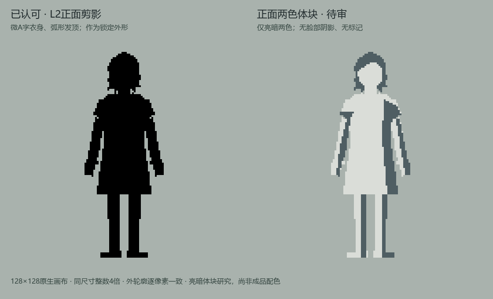

# L2 正面两色体块｜待审

用户已认可[正面剪影](../protagonist_l2_front_silhouette_v1/README.md)，本轮沿用它做正面亮暗两色版，**外轮廓完全锁定**。这是[重设计简报第4节](../../PROTAGONIST_REDESIGN_BRIEF.md#4-选定档位之后的顺序)的中间体块审查，尚非成品配色。

[并排审图](preview.html) · [原生 PNG](front_twotone.png) · [分层 Aseprite](editable/front_twotone.aseprite)

- 全图只使用已选 L2 比较稿中的两个中性研究色：亮 `#DADDD8`、暗 `#4F5E63`。不在这一步决定肤色、发色或衣料成品配色。
- 头发整体为暗块；面部开口只留平整亮色，不加眼部阴影、五官或标记。
- 休眠服用连续大亮面及沿微 A 字外缘延续的侧暗面；袖下、四肢侧面补简单暗块。不添加腰带、装饰褶或做旧。
- 原生 128×128，人物可见高度 117 px。轮廓透明度逐像素与认可剪影一致，变化为 **0 px**；不修改头身、发梢、衣摆、手脚或站姿。

## 可编辑源文件与核验

`editable/front_twotone.aseprite` 有亮色基底、暗色体块两个可见层，以及认可剪影的隐藏参照层。保存后回读像素与 PNG 一致。`source/manifest.json` 记录来源哈希、研究色、范围与工具调用；`source/validation.json` 记录轮廓及回读核验。

本轮按简报的简单体块研究方式制作，未调用 PixelLab、Tripo 或其他生成服务；不是以程序化绘制替代成品像素贴图。没有添加脸部阴影、P12／腕带或阶段二服装，没有制作侧背面、3D 或改动 Godot 正式场景。

下一步等用户确认两色体块，再决定进入剪影内成品上色。若使用 PixelLab，按已认可剪影锁定外形，保持简短提示词。
