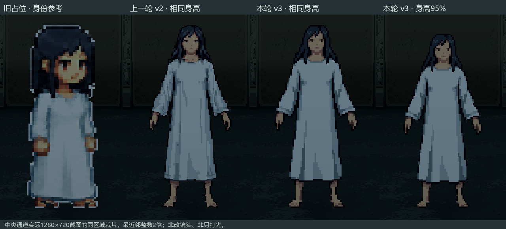

# 主角粗像素与实机尺度 v3

2026-11-17，**独立待审候选**。用户认为v2仍偏写实，希望像素再粗一点、视觉再矮一点，并在游戏里判断是否协调。本轮没有替换正式角色、房间、镜头、模型、布局或材质，也没有继续3D生成。

[并排对比页](preview.html) · [Markdown预览](preview.md) · [原生PNG](front_candidate.png) · [分层Aseprite](editable/front_candidate.aseprite)



上图取中央通道的实际1280×720截图，同一矩形裁切后最近邻整数2倍显示。四列依次为旧占位、v2等高、v3等高、v3统一缩小5%；没有另改镜头或补光。[v3短5%完整截图](evidence/game/02_front_middle_v3_PixelLab_short_95pct.png)可判断它与整间房的关系。

## 制作结果与观察

- PixelLab Pro重新绘制96×128原生图，人物可见高度117px、16种可见RGB色、二值透明。v2可见高度147px；等世界高度时，本轮原生像素边长增加约25.6%，不是仅把旧图整数放大后交付。
- 保留成人小头、蓝黑长发与刘海、简单冷白长袍和赤足。减少细长衣褶与碎高光，改为较大的连续明暗簇；不以放大头部实现矮小，也没有沿用旧占位的大头比例。
- 实际看图：v3的袖侧、袍侧、下摆阴影更连贯，室内也能读到更清楚的块面；脸部信息仍很少。是否足够接近用户选定的《武士零》《SIGNALIS》画法、是否采用短5%版本，均待用户审看，不能据技术通过宣告定稿。
- Pixel Canals继续作为场景像素观感硬参考；其他游戏只供比例与概括方式观察，**没有上传第三方作品图片**。

## 实机尺度：像素和身高分开比较

独立场景实例化已提交的`scenes/dev/room1_door_window_r30.tscn`，驱动为`scenes/dev/protagonist_room_context_v3.tscn`与`scripts/dev/protagonist_room_context_v3.gd`。不采用其他聊天尚在研究的门材质候选。

实际运行读取旧占位的`pixel_size × 96`，结果为1.4025m；这是已有“缩小15%”审图链的默认可见尺寸，不能误用最初1.65m作为基准。新图依据alpha脚底行定位，统一缩放两个轴，不做纵向压扁。

| 对比模式 | 原生画布 | 可见人物高度 | 此测试可见高度 | 原生像素／米 |
|---|---|---|---|---|
| 旧占位idle第0帧 | 96×128（原图集4帧） | 96px | 1.4025m | 68.45 |
| 上一轮v2 | 96×160 | 147px | 1.4025m | 104.81 |
| 本轮v3等高 | 96×128 | 117px | 1.4025m | 83.42 |
| 本轮v3短5% | 同一张v3，不再重画 | 117px | 1.3324m | 87.81 |

这些是**纸片审图可见尺寸**，不是重新设定主人公真实身高，也不是最终角色UV尺寸。v3等高接近场景80原生像素／米的制作起点；实际投影仍受镜头、表面方向和人物距离影响。短5%版像素相对v2仍更粗，但比v3等高版略细。

三个现有游戏镜头位置各拍四模式，共[12张原生实机截图与相机记录](evidence/game/capture_record.json)。中央通道采用已存在的`(10.5, 0.05, -4.75)`站位，避免邻舱挡脚。各组FOV50、内部与输出1280×720，先固定游戏跟随镜头再更换纸片。

**受光边界：**沿用现有`room1_sprite_player_strip_lighting_r2.gdshader`，它是`unshaded`加位置相关的灯带受光近似，不是最终3D动态GI、模型法线或皮肤材质。当前碰撞和接触阴影代理也不因候选身高改变；本轮只判断造型、像素与场景尺度。

## PixelLab来源与有界修正

使用官网Creator → Edit image → Pro，通过Chrome扩展操作；不走另计费API，不改换生成服务。

1. `source/adult_v2_original.png`是v2原始输出的字节相同副本。统一最近邻缩为77×128，再透明居中到96×128，得到`source/compact_GUIDE.png`。仅作构图／成人比例导图，没有手绘改像素，不能将它本身冒充完成的新图。
2. 第一次同时传这张导图和项目自有旧身份图`legacy_identity.png`，请求更紧凑的成人像素人物。结果又出现大头和幼态短身，已在交付前否决；保留`raw/rejected_head_attempt1.png`、对应提示词、元数据和网页证据，不作为候选。
3. 只做一次定向修正：移除辅助旧身份图，仅以已有成人比例导图锁定头身／肩颈／四肢，让PixelLab简化画法，不再压缩身体。最终原图为`raw/front.png`，网站设置与结果见[元数据](source/creator_metadata.txt)和[截图](evidence/pixellab_result.jpg)。辅助图是否导致第一次比例偏移只是制作判断，不能证明模型内部原因。
4. 最终PNG与原始输出字节相同。Aseprite保留PixelLab原图、两张隐藏导图和空白局部精修层；没有本地绘画、程序化造型、重着色或重绘主体。

网页实扣：**56→66→76／2000，共20额度**，余1924；页面显示12月13日重置／续费。[请求、两次输入、提示词及额度记录](source/generation_record.json)均保留。未额外购买或更改订阅。

## 验证与复现

- [图像与Aseprite验证](source/validation.json)：117px可见高度；alpha一致、可见像素差异0；四图层及隐藏状态已读回；原图SHA-256为`35889c3e1cef6e2b29228822edd8021006b489328816d58e434f29ca65d540fb`。
- [实机验证](source/game_validation.json)：12张实际截图；每组相机一致；固定人物区域`(540,240)-(740,530)`之外像素完全相同。该结果证明对照条件一致，不等于用户美术批准。
- 实际看过等高人物图、完整房间图、三机位四模式总览及游戏裁片；脚部定位、前后遮挡和原生像素都可直接审看。中央机位无遮挡；保留其他机位的真实舱体遮挡。
- GUI运行使用Godot4.6.2 Compatibility，成功退出，没有脚本解析／运行错误。此前受限环境的headless导入产生用户目录写权限提示；正式截图运行使用正常用户目录权限完成，没有通过改项目配置规避。

```powershell
# 在仓库根目录运行；docs/art不参与Godot导入，审图驱动直接读取PNG。
& 'C:/文件类/GODOT/Godot_v4.6.2-stable_win64_console.exe' --path . --rendering-method gl_compatibility --resolution 1280x720 --max-fps 60 res://scenes/dev/protagonist_room_context_v3.tscn -- --capture
python docs/art/experiments/protagonist_legacy_refine_v3/source/build_game_review.py
```

手动F6运行独立场景后，1／2／3／4切换四模式，逗号／句号切换机位，H隐藏说明。此为静态审图，不驱动候选行走或旋转。确认正面与实机尺度后再补一致的侧背面；本轮没有批量生成动作、3D、UV或绑定。
