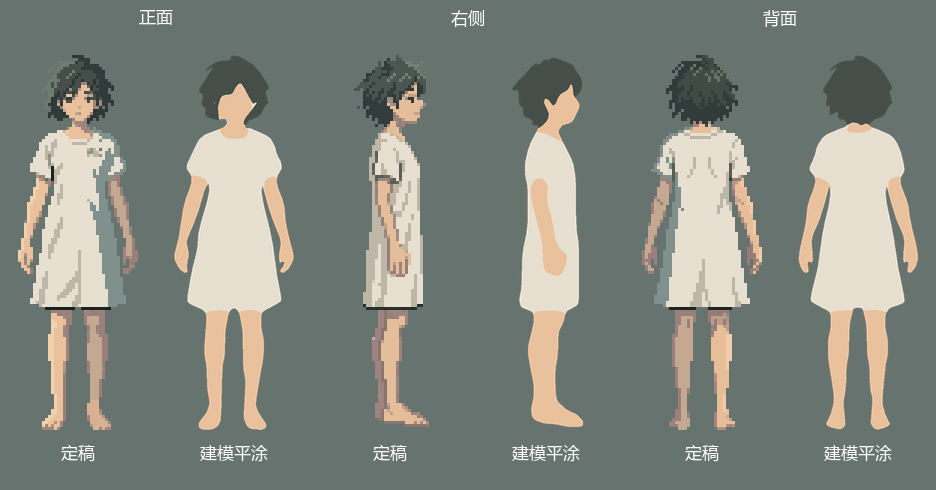

# 阶段一主角 · 建模用平涂三视图

三张透明 PNG 共用 1024×1024 画布。保留定稿的画布坐标，各方向分别等比放大八倍。人物自身的右侧朝画面右方。头发、皮肤、休眠服各占一个平涂色，脸部、衣料和腿上明暗留到贴图阶段。轮廓沿定稿像素边界取样并平滑，围绕发梢及指尖等极小特征有局部取舍。

| 方向 | 定稿 | 建模输入 |
|---|---|---|
| 正面 | [衣色 B、原脸](../protagonist_front_c_raw_v2/B_original.png) | [front.png](front.png) |
| 人物右侧 | [eye_v4](../protagonist_side_eye_v4/side.png) | [right.png](right.png) |
| 背面 | [背面定稿](../protagonist_back_v1/back.png) | [back.png](back.png) |

[生成平涂副本和对照图的脚本](build.py) 使用 Python、Pillow、NumPy 和 Windows 微软雅黑字体。此轮仅供审核建模参考图，未提交 Tripo 任务。
