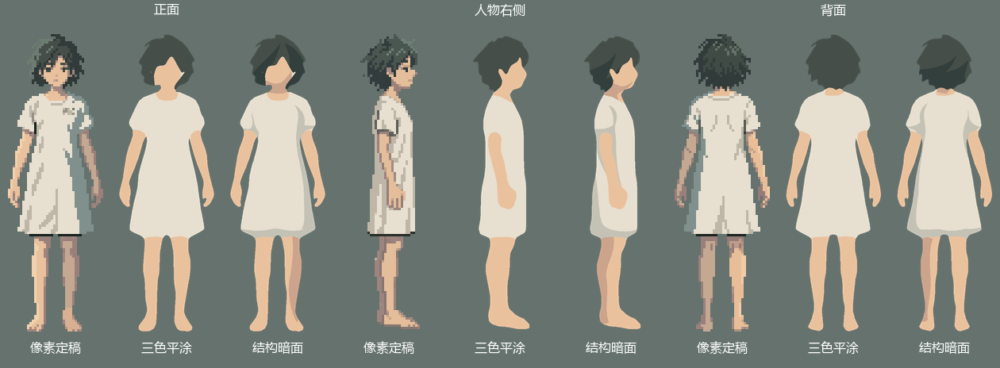

# 主角建模三视图 · 结构暗面审稿

[正面](front.png) · [人物右侧](right.png) · [背面](back.png)

每张以同角度的[平涂副本](../protagonist_model_flats_v1/README.md)为底，保留 1024×1024 画布与原透明度。头发、皮肤、布料分别增加一档暗色，形状按视角绘制。重点是发层、下颌与颈的边界、短袖、腋下和薄下摆。腿部仅保留纵向转面。此稿供人工审核三维建模参考。build.py 可重建 PNG 和同倍率对照图。
