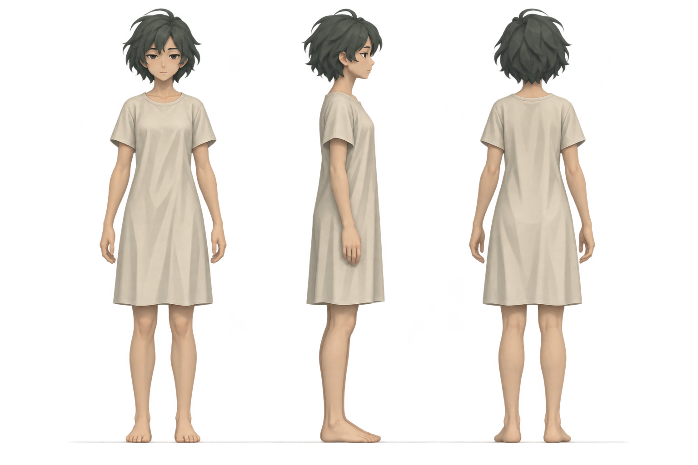

# 阶段一主角 · 建模造型参考 V3

[正面](front.png) · [人物右侧](right.png) · [背面](back.png)

以正面 B_original、右侧 eye_v4、背面 back 定稿三张像素原图为直接输入，使用 ImageGen 一次生成同角色正交三视图。三张单视图取自同一原始透明 PNG，只水平居中到同尺寸画布，保留竖直位置和比例。此版本用于观察薄衣和身体的空间关系。生成图的头发分束、五官和领口是对定稿的解释，未验证 Tripo 的几何或分件结果。
