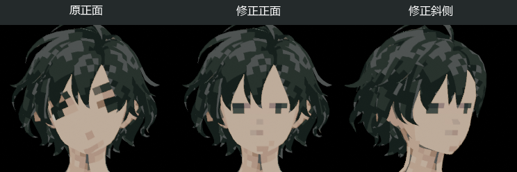
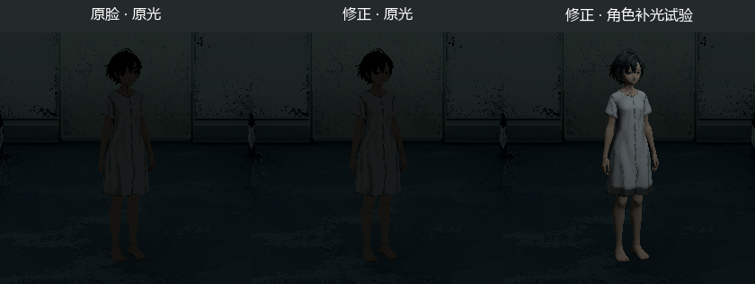

# R5 脸部 UV 对位

第一版的眼睛沿图集水平方向绘制，斜展的面部 UV 使两眼贴回网格后错高。单独取脸部 688 个三角面，展开到 128 图集的空区，使眼线对应同一头部高度。两眼与口鼻采用已认可的 PixelLab 正面 B 原脸的像素与色调。Aseprite 在上一版母版上单独叠加脸层，未重新生成主体。脚本核对原生像素中心覆盖范围，脸部新位置和一像素扩边未覆盖其余岛的采样中心。阶段一网格、骨架与 walk 延续。

[角色 GLB](walk_pixel.glb) · [Aseprite 母版](face.aseprite) · [修正后的侧面](after_side.png) · [原光迈步](room_128_walk.png) · [补光迈步](room_fill_128_walk.png)

中性光近景检查原版、修正后的正面、斜侧和侧面。Room 1 保留 1280×720、1.4025 米参考高度，角色补光为审图用独立试验（冷白点光，仅照角色，能量 0.45），未加入游戏入口。补光下脸和衣服均清楚，但衣袍与舱体的明度差偏大。正式光照与最终表情待审。

source/align.py 提取面部岛并生成像素层与 face_uv.npy，source/edit.lua 用 Aseprite 合成，source/package.py 写入面部 UV 和贴图。raw 主体继续追溯至上一版。
