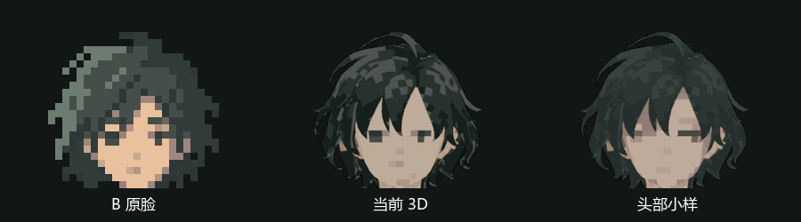

# 阶段一主角 · B 原脸神态小样

正面按头顶至下巴等高展示，B 按原像素最近邻放大。两个 3D 版本使用同一正交机位和中性平光。[斜侧](after_three_quarter.png) · [人物右侧](after_side.png) · [带贴图的模型](walk_pixel.glb) · [可编辑 Aseprite](head.aseprite)

沿用 V2 几何、蒙皮、UV 和 128 图集。以已确认的 PixelLab B 原脸为源，在对齐过的脸岛上转入眼睑、口鼻、鬓角到脸颊的肤色关系，收低鼻口对比；对已有 PixelLab 发色的亮阶作局部调色。Aseprite 两个独立层用于分别检查神态和发色。没有重新调用 PixelLab 或 Tripo。当前仅为审图候选，头部正面、斜侧和侧面均已渲染。发梢和头顶细束仍是 R5 的轮廓。
