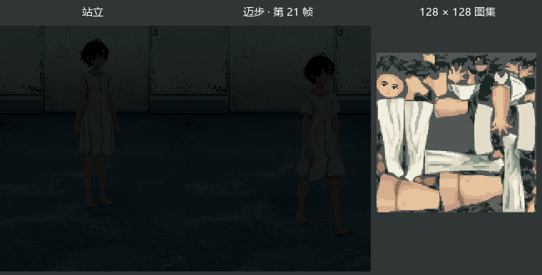

# 阶段一主角 · PixelLab 128 贴图小样

[中性光正面](neutral.png) · [站立全画面](room_128_stand.png) · [行走全画面](room_128_walk.png) · [内嵌贴图动作 GLB](walk_pixel.glb) · [Aseprite 分层母版](skin.aseprite) · [原生贴图](skin.png)

使用已认可 R5 裙摆修正版和 128 档智能 UV。prepare.py 按原三角面的对应关系，把项目自有的临时 Tripo 材质投到新 UV 上，得到定位导图。PixelLab 网页创作台「编辑图像／专业版」一次，第一张用 source/guide.png，第二张用已确认的 protagonist_front_c_raw_v2/B_original.png。提交时显示 10 generations，未核对余额。关闭移除背景，128×128，提示词在 source/prompt.txt。raw/pixellab.png 是下载原图，直接用于全身材质。Aseprite 两层分别为隐藏导图和可见的 PixelLab 原图。没有局部人工绘制。

Godot 4.6.2 在 Room 1 现有机位按 1.4025 米测试，1280×720，最近邻。中性光下短发、暖白袍和灰绿衣褶可辨，袖口和衣摆均可辨认。实机里衣袍整体偏暗，脸与发际的阴影几乎连在一起。袖肩有少量碎色，裙身中央有一条较直的细折线。记录为小样，未替换正式场景。站立与第 21 帧用于材质验看，未覆盖完整步态及所有接缝。
