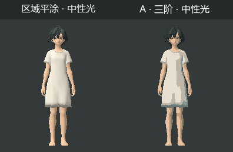
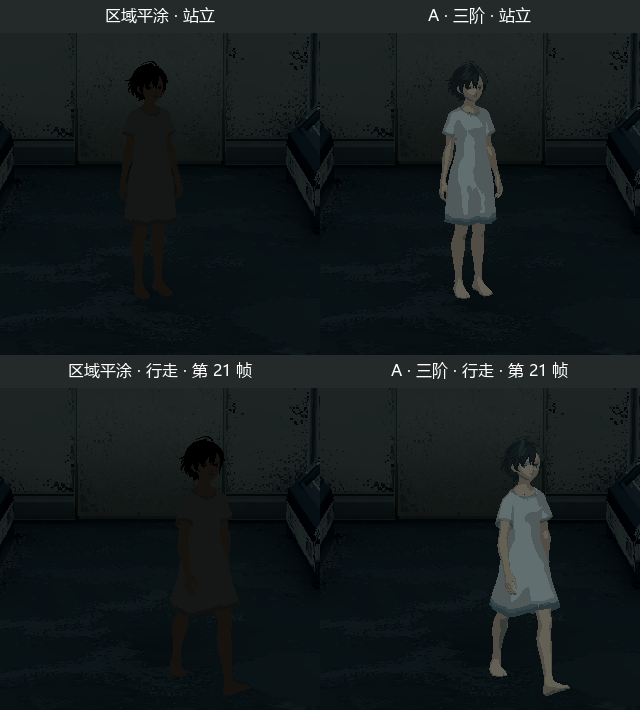

# R5 分阶光照 A

区域平涂 v4 的同一 GLB、128 图集、脸部像素和 walk 动作，两边仅切换角色材质。neutral.gd 与 room.gd 是独立审图入口。正式游戏场景没有更新。A 是 Godot shader，原有 GLB 继续引用 [v4](../protagonist_r5_flat_v4/walk_pixel.glb)。bind.gd 将相同材质参数分别绑定到三个表面并保留各自的贴图。

B 原图白袍取样为亮 (231,223,207)、中 (190,182,167)、暗 (128,144,140)。使用两个 step 按法线与入光方向分三阶，以暖白为基准将同一色阶比例应用于各表面，保留头发和肤色的本色。中性光采用固定方向，原图三个 RGB 在 Godot 输出中均有实测命中，见 qa.json。

Room 1 的动态角色无法直接读取静态墙地的烘焙图。A 沿用 room1_actor_strip_lighting_r1 的前后两排、每排八个灯带采样点，对世界法线作距离加权；整体冷色调、距离衰减与关闭后 0.10 应急底光取自 room1_sprite_player_strip_lighting_r2。角色中心用于统一整体亮度，避免在每个色阶内再引入渐变。每帧读取房间 strip_on。没有加灯、光晕或改曝光。原 v4 对照使用标准材质，A 使用上述动态角色灯带近似，因此房间对照同时显示了受光模型带来的亮度差异。中性光用同方向平行光（平涂）和相同方向参数（A）。

Room 1 使用 Godot 4.6.2 Compatibility、1280×720、既有机位、1.4025 米角色高度。站立与 walk 第 21 帧。背景像素差异范围限定于人物框。提供完整 [平涂站](before_room_stand.png)、[A 站](after_room_stand.png)、[平涂走](before_room_walk.png)、[A 走](after_room_walk.png)。本轮未制作方案 B。
