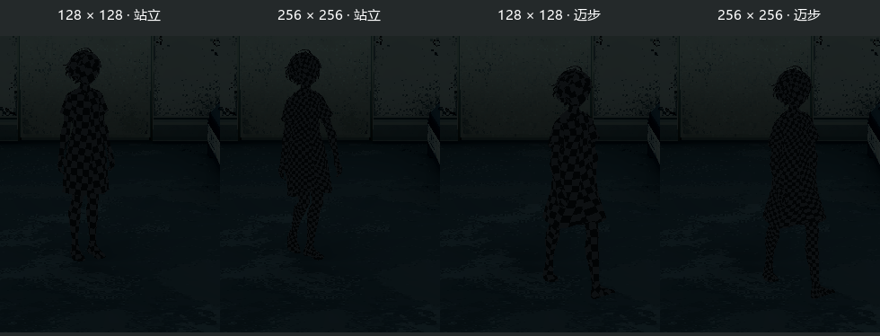

# R5 智能 UV 与原生贴图尺度试验

[可绘制的角色 GLB](walk_uv.glb) · [UV 线框布局](uv_layout.png) · [测量](metrics.json) · [Tripo 导出](tripo_uv.glb) · [云端任务](https://studio.tripo3d.com/workspace/smart-uv/0f1eafa3-9fbf-487f-9e45-efaa5f741d31)

国内站智能 UV 第一个候选，消耗一次免费试用，余额 1195。保存到云端 R5 后导出。云端依据仍是有底片的 8563 面模型，仅用它提供 UV。逐三角形按三个顶点的精确位置匹配到已修裙摆的 8533 面 GLB，全部唯一匹配。按新 UV 拆分渲染顶点并复制原顶点位置、法线与蒙皮。原骨架与 walk 动画数据保持原样。新材质为中性占位，游戏正式资源未替换。

同一套使用中三角面的 UV 岛数从 1104 降到 89；按 256 方图换算，面积不足 4 个纹素的岛从 531 降到 2。新图无零面积 UV 三角形，坐标均在 0–1。有效三角形 UV 面积之和为 0.724，不等于无重叠证明。Tripo 页面按云端全模型显示利用率 77.4%。线框为 glTF 图像方向，1024 仅作展开示意。

Godot 4.6.2 以 Room 1 原镜头、角色高度 1.4025 米、1280×720、最近邻和灰阶测试格拍摄。每个格子占 4×4 原生纹素。站立与迈步分别对比 128 和 256。按使用中的三角形表面积估算，全身平均密度分别约 89 和 179 纹素／米。建议正式绘画先按 128 档，经白袍、脸与发束的 PixelLab 小样决定局部细节。UV 边缘外扩和接缝仍需随正式色块实测。测试格不代表角色最终明度。

[128 站立](room_128_stand.png) · [256 站立](room_256_stand.png) · [128 迈步](room_128_walk.png) · [256 迈步](room_256_walk.png)。uv.py 从两份原始导出构建试样，room_capture.gd 从项目根目录通过 Godot --script 运行，compare.py 作等像素裁切。
