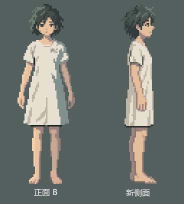
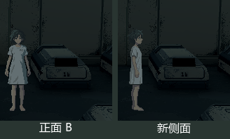
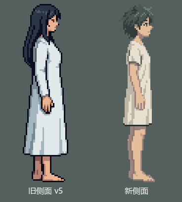

# 主角阶段一 · 朝右侧面审图

正面依据是已定稿的 B_original.png。第三次 PixelLab 输出作为[侧面候选](side.png)，[Aseprite 源文件](side.aseprite)含原图层与衣色 B 修色层。脸、头发、脚和站姿均来自原图，未配准或缩窄。衣身亮面与中间调在 Aseprite 内分别统一为 #E7DFCF 和 #BEB6A7。侧面暗部偏暖，头发后缘比正面略蓬，侧脸的鼻尖比正面突出。衣摆位置与正面接近，赤脚站立自然。

原生坐标从 0 开始，取 y=46 的下胸位置，正面两臂已与衣身分开，衣身 x=56～72 共 17 px。侧面衣身在前臂前后都可见，以前后衣缘 x=58～73 量得 16 px，手臂投影在衣身内。侧厚／正宽为 0.94，高于 0.55～0.65 目标。该值量的是穿衣外形。下摆仍比胸口厚；前缘已基本垂直，后缘仍向脚跟外放。第三稿比前两次收得更直，尚未完全达到薄布自然下垂的预期。三次后停在此处供审查，未用变形工具挤压身形。

Room 1 图复用正面审图的实机截图背景、亮度系数、脚底位置与 117 px 显示高度，静态合成。正面、侧面独立等比缩放。旧 v5 图来自项目本地留存的 protagonist_apose_turnaround_v5/raw/side.png，此处保留输入以便重建审图。

[请求与额度](prompts.txt) · [第一稿](raw/master.png) · [体块导图](raw/guide.png) · [第二稿](raw/guided.png) · [第三稿](raw/tailored.png)。三次均使用 PixelLab 网页 Edit image Pro，按钮标价合计 30 generations，未核对账单差额。
