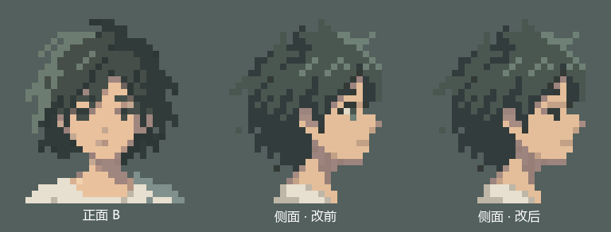
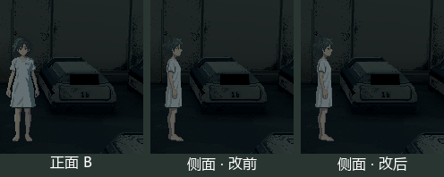

# 阶段一侧面 · 半垂眼

以已认可手腿的 limb_v3 为底，在 Aseprite 顶部独立图层改了 6 个原生像素。上眼睑的主暗线压低一行，虹膜和眼睑取正面 B 的 #313B3A。青绿和亮眼白已去掉，眼睛仍在原来的高度范围内。逐像素对比确认鼻、嘴、下巴、头发、手腿及轮廓均沿用轻收版。

头部为最近邻 8 倍；Room 1 图复用同一张实机背景、受光系数与脚底坐标，人物显示高度 117 px，静态合成。本次 PixelLab 调用 0 次。侧眼待审，背面暂缓。

[可编辑母版](side.aseprite) · [128×128 PNG](side.png)
