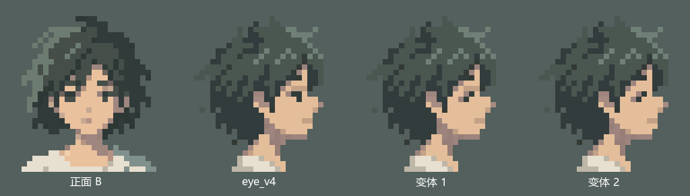
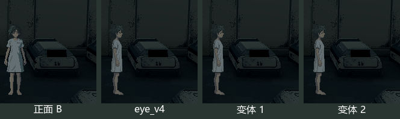

# 侧眼神情 · 两个待选变体

两份 Aseprite 工程均从 eye_v4 开始，顶部独立图层可切换回原稿。变体 1 调整 5 个像素，眼睑后段下落一行，深色瞳点向中央收一格。变体 2 沿用相同眼形，额外将眼睛上方一行 3 个像素换成邻近肤色。沿用正面眼部深色 #313B3A，未调用生成服务。对导出 PNG 逐像素验证了差异坐标。

两组都按正面 B、eye_v4、变体 1、变体 2 排列。上图用同一裁窗最近邻放大 8 倍；下图使用同一张 Room 1 实机截图背景及受光系数，人物以 117 px 高度静态合成。选择待用户确认。

[变体 1 PNG](variant_1.png) · [变体 1 Aseprite](variant_1.aseprite) · [变体 2 PNG](variant_2.png) · [变体 2 Aseprite](variant_2.aseprite)
