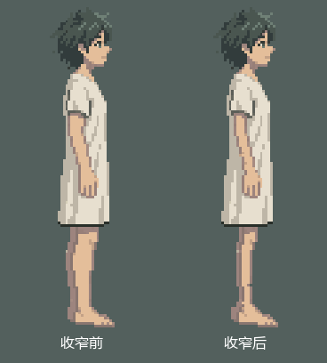
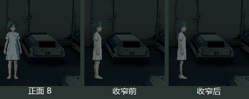

# 主角右侧面 · 手臂与腿收窄

沿用侧面 v1 及正面 B。在 Aseprite 内沿原有四肢中心线局部收窄，肘与膝保留原来的高度和转折。仅修改原生 y=45～67 的手臂和 y=88～118 的腿；手、脚、衣身外缘与头部沿用原图。修后手臂约 5 px、膝部 7 px、小腿 5～6 px，按侧面两腿重叠后的总宽计。颜色取自各自原行，手臂两侧补出原衣色。未调用生成服务。

Room 1 使用与 v1 相同的实机截图背景、受光系数、脚底位置和 117 px 显示高度，静态合成。左至右为正面 B、收窄前、收窄后。侧面待用户确认，背面暂缓。

[128×128 原图](side.png) · [Aseprite 源文件](side.aseprite) · [与正面 B 对照](compare.png)。源文件保留旧稿两层，顶部是本次可编辑结果。
