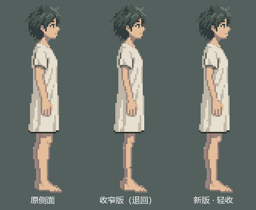
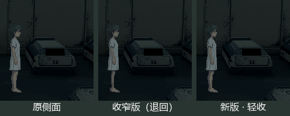

# 侧面四肢轻收 · 待确认

从原侧面 v1 直接在 Aseprite 编辑。手臂前缘收 1 px，沿用原肘部和手掌。腿只从胫骨一侧收 1 px，膝部附近收 2 px，保留原片中的后腿重叠暗色。小腿肚的后缘逐行核对一致，脚和衣摆保留原像素。PixelLab 新请求 0 次。

依次为原侧面、已退回的收窄版、新轻收版。上图原生像素整数 3 倍；下图沿用上轮 Room 1 实机截图背景与受光系数，人物高 117 px，为静态合成。背面等本稿确认。可编辑源文件 side.aseprite 含原稿隐藏图层和新版可见图层。
