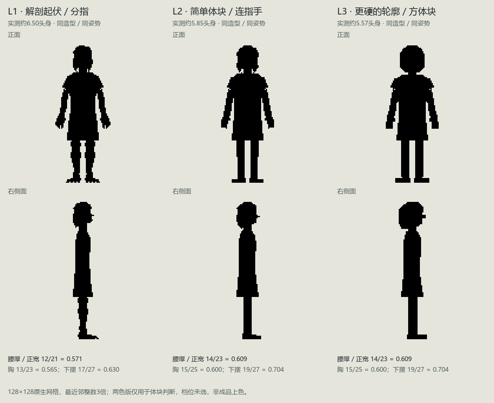
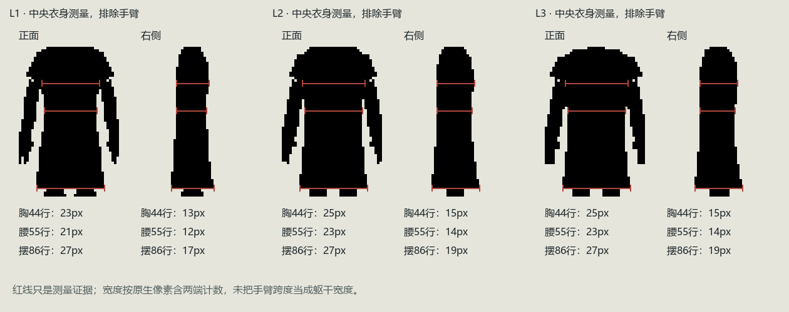
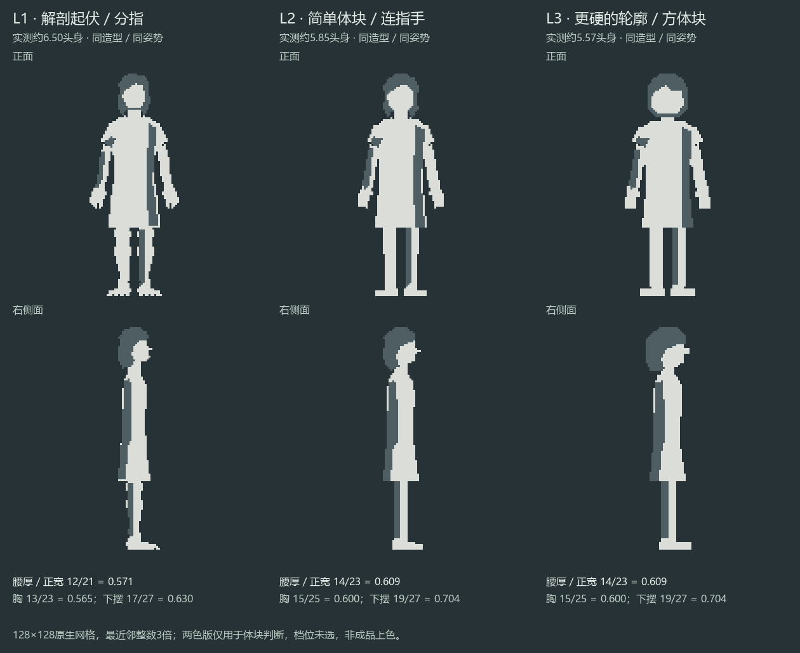
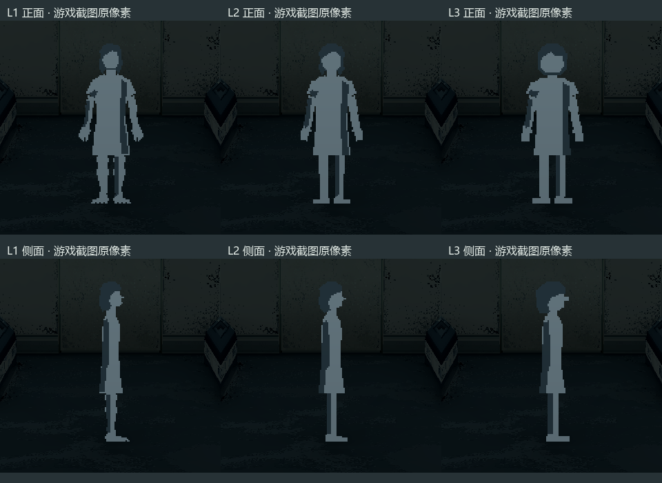

# 阶段一主角：L1／L2／L3简化程度比较

2026-11-17。**只执行新版[主角重设计简报第3节](../../PROTAGONIST_REDESIGN_BRIEF.md#3-简化程度三档剪影比较下一轮唯一任务)，三档均待用户选择。** 本次用户明确授权Aseprite／简单几何研究，并明确不调用PixelLab、Tripo；优先于旧S1～S3和v4／v5外形、面料及制作约束。

[完整审图页](preview.html) · [Markdown预览](preview.md) · [可编辑Aseprite](editable/L123_comparison.aseprite) · [实测数据](source/measurements.json) · [验证记录](source/validation.json)



## 相同项与比较变量

三档均为同一阶段一造型：**齐耳至下颌附近、略乱且未扎起的短发；短袖、约及膝的薄休眠服；赤脚。** 统一自然站姿，双臂略离身，侧面投影自然重叠。不是沿用v4的45°A姿势，也不是新绑定参考。衣长、脚底位置、整体身高、站距和两色试验用色保持一致；没有对襟、腰带、口袋、纽扣、P12编号、腕带或额外饰物。

- **L1：**约6.5头身，保留肩肘、膝／小腿的解剖起伏，手指／脚趾有小间隔，侧脸转折较细。
- **L2：**约6头身，躯干和四肢归纳成较简单的体块；手为连指手套加拇指，脚为整块，减少局部起伏。
- **L3：**约5.5～6头身，轮廓转折更硬，头发和衣身减少转折，腿与脚更方；继续概括连指手，不加入更细的解剖信息。

本轮仅比较档位，不制作背面、成品脸部／眼部阴影、最终颜色、材质纹理、阶段二服装或新3D；未采纳阶段二换装剧情提案。也没有改`CHARACTER_DESIGN.md`中的最终比例规则。

## 原生尺寸与头身

每档正面、右侧面各有一张纯黑剪影和一张两色图，共12张原生PNG。画布均128×128，头顶首行y6、脚底末行y122（exclusive y123），可见高117px；只沿用v4的这一高度定位，**没有载入或描摹v4／v5人物图**。

头高按新几何图中头顶至下颌最后一行、含两端计数；不把短发垂到颈侧的发尾当作下巴。头身按117px可见高除以头高计算：

| 档位 | 头顶／下颌最后行 | 头高 | 实测头身 | 简报目标 |
|---|---|---|---|---|
| L1 | 6／23 | 18px | 6.50 | 约6.5 |
| L2 | 6／25 | 20px | 5.85 | 约6 |
| L3 | 6／26 | 21px | 5.57 | 5.5～6 |

128px网格无法精确表示19.5px头高，因此L2取20px；没有为凑整数比例整体拉伸或重采样。正侧面使用相同的下颌定位。

## 侧厚／正宽实测

从最终原生像素的**独立衣身测量层**读数，排除手臂跨度。像素宽度为`x_max - x_min + 1`。胸部用y44，腰部y55，下摆y86；胸部短袖可能接触衣身，所以测量层明确排除袖臂。腰、下摆同时复核黑剪影的中央连续像素段。

| 档位 | 胸厚／正宽 | 腰厚／正宽 | 下摆厚／正宽 |
|---|---|---|---|
| L1 | 13/23＝0.565 | 12/21＝0.571 | 17/27＝0.630 |
| L2 | 15/25＝0.600 | 14/23＝0.609 | 19/27＝0.704 |
| L3 | 15/25＝0.600 | 14/23＝0.609 | 19/27＝0.704 |

三档胸腰均在0.55～0.65内，下摆均不超过0.8。另逐行检查躯干y40～64的厚宽比，也全部在0.55～0.65内；不是只挑一条满足的测量线。完整边界坐标与每档比例区间在[测量JSON](source/measurements.json)。这些是本候选的像素实测，不是人体或真实面料的物理定律。



红线只存在于证据排版，不进入纯黑PNG、两色PNG或游戏输入。

## 两色平涂：只看体块



六张两色图统一只用亮面RGB`218,221,216`和暗面RGB`79,94,99`，透明为0／255，未使用半透明、抗锯齿、渐变、噪点或织纹。黑剪影可见像素全部RGB`0,0,0`。每一对黑剪影与两色图的alpha完全一致。

第3节的L1描述含“皮肤多层过渡”，但本轮交付又明确要求两色平涂，因此L1只通过轮廓展示解剖与分指特征，三档都限制为同两色；没有把L1额外上成多色成品，避免将明暗精细度与形体变量混在一起。这两种灰色也不是角色最终配色。

## Room 1实际游戏大小

独立审图场景为`scenes/dev/protagonist_simplification_l123.tscn`，实例化已冻结的`room1_door_light_recess_b1.tscn`：墙r24、地r26、舱r28、门面r32、门灯B和暗玻璃小窗。没有修改这些环境资源或正式占位角色。

六张[完整1280×720游戏截图](evidence/game/capture_record.json)均在中央通道`(10.5,0.05,-4.75)`、原游戏跟随镜头、50°FOV拍摄。先固定一次相机，再依次替换审图纸片；人物和舱体处于同一实际渲染画面，并非把立绘后贴进截图。

从继承场景读取`paper_hero.pixel_size × 96`得到当前可见高**1.4025m**；六图统一按117原生像素换算，约**83.42原生像素／米**，脚底按alpha末行对齐。保持图像等比，未压扁某一档。这个数值只是当前占位链的实际可见尺度，不是新确定的主角设定身高。



上图每格从实际截图的`(480,230)-(800,540)`裁取，**没有缩小或放大**；原生文件内1像素对应实际截图1像素。网页／聊天窗口可能整体缩放显示，判断精确颗粒时请打开原图1:1看。完整截图中的舱体与场景保留，可直接判断尺寸。

角色沿用既有纸片灯带受光近似，所以游戏里的两色会受现有着色器调制；这不是新3D模型法线、材质或动态GI验收。六模式相机矩阵完全相同，固定人物区域之外的房间像素完全一致。

## 可编辑源与复现

`editable/L123_comparison.aseprite`为256×384原生六格母版：列为正／侧、行为L1／L2／L3。每格四层，共24层：亮色体块、暗面、隐藏纯黑剪影、隐藏衣身测量层。黑剪影和测量层默认隐藏；要看某一格的黑剪影，关闭该格亮／暗面并开启该格黑层即可。原生PNG始终独立保留，避免误把证据图或标注当素材。

本轮是用户明确授权的**整数坐标简单几何研究**。`source/draw_candidates.py`从新绘多边形创建掩码，没有读取旧主角图、旧模型或任何第三方参考；`source/geometry.json`保存所有顶点、头顶脚底与姿势说明。不是AI生成、不是旧图变形，也不是最终像素绘画。

```powershell
python docs/art/experiments/protagonist_simplification_l123/source/draw_candidates.py
python docs/art/experiments/protagonist_simplification_l123/source/package_editable.py
& 'C:/文件类/GODOT/Godot_v4.6.2-stable_win64_console.exe' --path . --rendering-method gl_compatibility --resolution 1280x720 --max-fps 60 res://scenes/dev/protagonist_simplification_l123.tscn -- --capture
python docs/art/experiments/protagonist_simplification_l123/source/build_review.py
```

Python需Pillow；Aseprite路径可用`--aseprite`指定。F6运行独立场景时1～6依次切换L1正／侧、L2正／侧、L3正／侧，H显隐说明。`docs/art`不参与Godot导入，驱动直接读取本轮PNG，不更改导入规则。

## 已检查与未批准

- 已读回Aseprite：可见像素与alpha和原生两色图完全一致；alpha为0的不可见RGB不作画面差异。
- 原生尺寸、纯黑／两色、头脚位置、测量比例与所有24层的隐藏状态通过检查。
- 实际看过黑剪影、两色比较、测量证据、游戏原像素裁片与完整游戏图；六张截图已验证同机位、同环境。
- Godot4.6.2 Compatibility实际渲染正常完成；新脚本／场景仅作审图，未替换正式角色、镜头、布局或碰撞。
- **PixelLab调用0，Tripo调用0，其他图像生成调用0，本轮生成额度消耗0。**
- **L1／L2／L3均未被采用。** 等用户选档或指出需要组合／调整的位置，再按新版Brief第4节推进；本轮不提前做最终上色、背面或3D。
