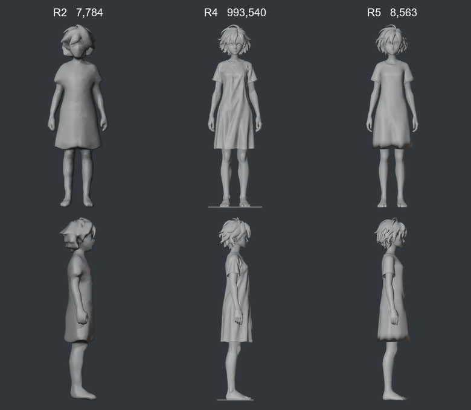

# 主角 R5 · Tripo P2.0 智能网格

[原始 GLB](mesh.glb) · [斜视](mesh_oblique.png) · [背面](mesh_back.png) · [面数与骨骼统计](mesh_metrics.json) · [连通块检查](connectivity.json)

国内 Studio 以 [V3 三视图](../protagonist_model_turnaround_v3/README.md)直接生成智能网格。用了前、人物右侧、后三个槽，左侧留空。P2.0，数量 1，三角面目标 8,000。扣 100 积分，1,325 → 1,225。[Tripo 任务](https://studio.tripo3d.com/workspace/generate/0f1eafa3-9fbf-487f-9e45-efaa5f741d31)

Blender 回读为 8,563 个三角面，一个网格对象。发束和短袖轮廓比 R2 清楚，脚底没有 R4 伸出的薄板。侧面仍可见细碎后发，裙摆边缘鼓起，缺少 R4 的垂感。连通性在副本中以 0.000001 距离合并重合点后检查，两条腿各有一个从脚底延伸至身高约 45% 的连通块。导出物没有命名的可换衣部件、骨架或动作，本次证据仅覆盖静态模型。原 GLB 保持导出状态。

四个单视图用 [R4 的 Blender 脚本](../protagonist_turnaround_tripo_r4/review.py)生成，compare.py 制作等高对比。
