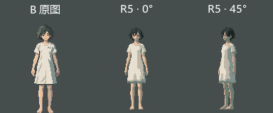
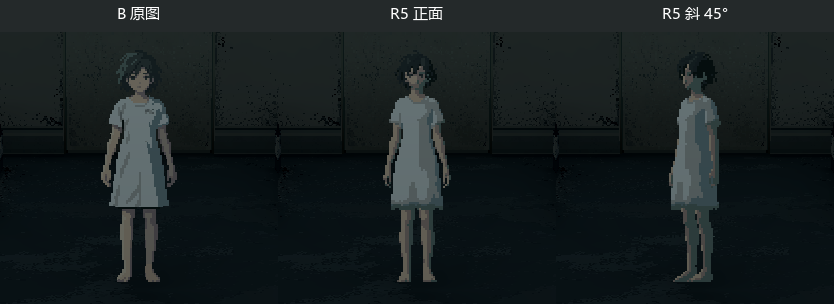

# R5 离线渲染为原生 2D 精灵 · 两张站立帧

[三倍最近邻](compare_3x.png) · [正面 PNG](sprite_0.png) · [斜 45° PNG](sprite_45.png) · [限色前正面](raw_0.png) · [限色前斜面](raw_45.png) · [像素实测](metrics.json)

Godot Compatibility 在独立透明 128×128 SubViewport 直接渲染区域平涂 R5 和现有 A 着色器，保持站姿、正交投影、同一世界光向。相机绕人物竖轴旋转 45°。禁用 MSAA、屏幕空间 AA、TAA 与去色带，保留 A 贴图的最近邻采样。两帧不透明包围盒高均为 117 px，透明度仅 0 或 255。palette.py 按不透明 B 原图的 17 个 RGB 色，用 RGB 距离映射最近颜色；正面用 13 色，斜面用 12 色。未抖动、未修像素、无生成调用。B 原图 128×128，实测人物高 125 px，在原尺寸并排图中完整照放。

Room 1 的三次实机截图都通过原有 Sprite3D 和纸片受光材质取景，沿用站位、50° 相机设置、房间灯光和角色可见高度约 1.4025 m。根据各 PNG 的不透明高度换算 pixel_size，并将脚底对齐。画幅 1280×720，[B](room_B.png)、[正面](room_0.png)、[斜 45°](room_45.png)。对比图用同一矩形截取，不调亮。正式入口不变，本轮只测站立。
