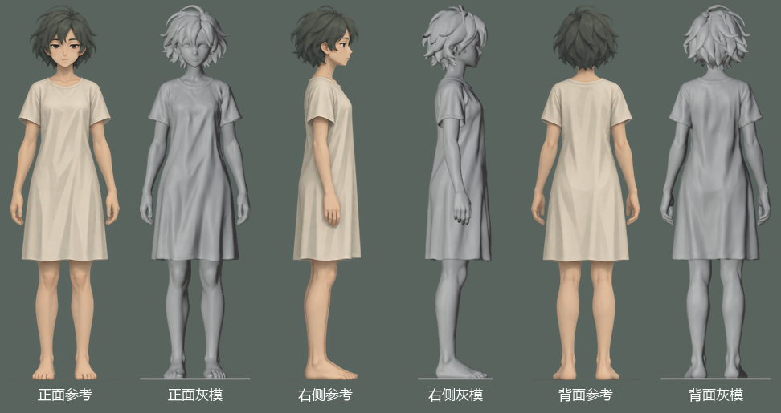

# V3 建模三视图 · Tripo 分件灰模 R4

[原始 GLB](parts.glb) · [分件单独显示](isolated.png) · [斜视](parts_oblique.png) · [网格统计](parts_metrics.json)

以现有 [V3 生图三视图](../protagonist_model_turnaround_v3/README.md)作为输入。国内版 Tripo H3.1 标准精度、标准分部件、三角面，贴图关闭。槽位为前、人物右侧、后；左侧槽空。生成一次，余额 1370 → 1325，扣 45 积分。[任务](https://studio.tripo3d.com/workspace/generate/9974ff6c-c486-4e50-a64a-a02da3e7cf72)。

原始文件有 12 个网格、993540 个三角面。Blender 仅作回读和渲染。侧视能读出袖口边缘、上臂和垂下的衣摆；分件检查显示衣身和两腿分开，一个短袖又被单独分出。衣下没有可独立显示的完整躯干。头发为一个网格，大束方向与参考接近，鬓角和后颈发尖仍密。脚下多出一片薄平面，单显部件 2 时仍可见。此次验证静态体积；本轮未做低模或绑骨，未重生参考图。分件图逐件放大，大小仅作辨认，比例以整人图为准。
