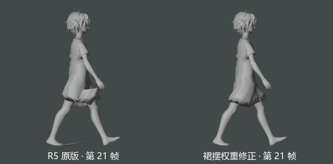

# R5 休眠服裙摆行走修正

[动作 GLB](walk.glb) · [侧面八帧](walk_s_frames.png) · [正面八帧](walk_f_frames.png) · [原版](../protagonist_smart_mesh_walk_r5/README.md)

基于 R5 已绑定动作 GLB，只修改衣身下部的蒙皮和角色索引中的足底平片。以腰部和双侧大腿的平滑权重控制裙摆，沿身高向上过渡回原权重。删去足底片的 30 个三角面。正式场景与原始 R5 保留。没有额外使用 Tripo 积分。

Blender 回读 8533 个角色三角面、41 骨、原 walk 动作 0–56 帧。沿用原 R5 的 review.py 和 strain.py，对照正侧各八帧，第 21、49 帧原先被手提起的裙角已落下。仍能看到原有厚褶；本轮没有逐帧做布料碰撞检测。全身边长比最大约 2.53，不能据此宣称全身蒙皮通过。fix.py 从原 R5 生成动作文件，contact.py 和 compare.py 生成审图。
