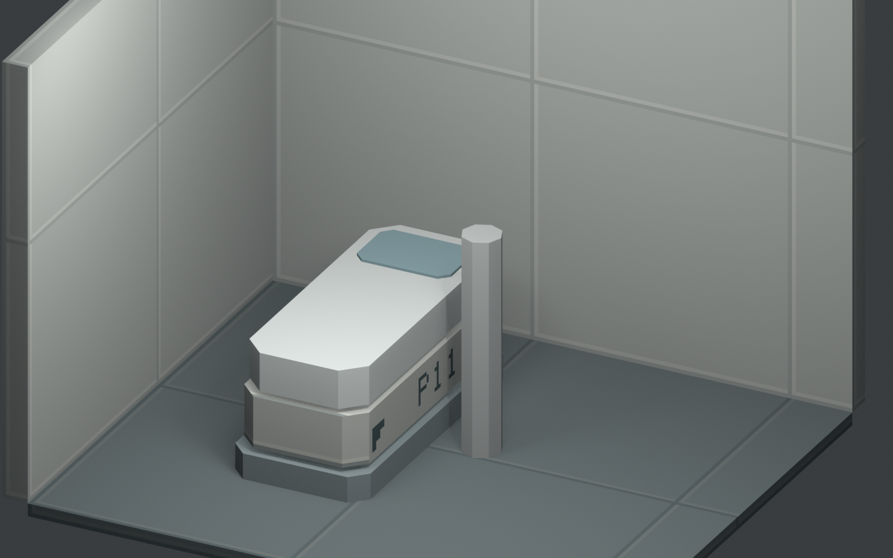
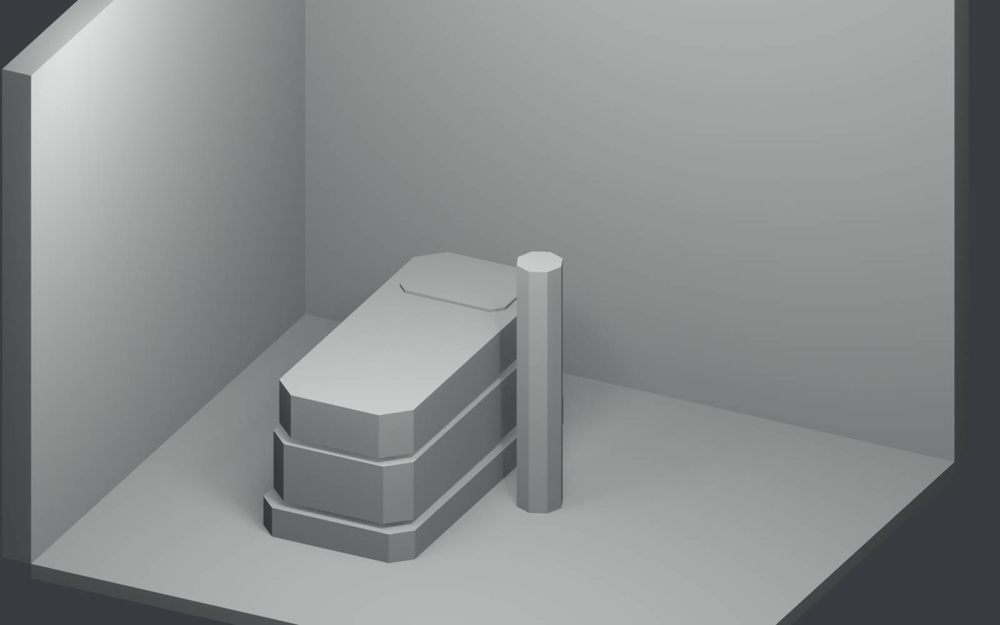
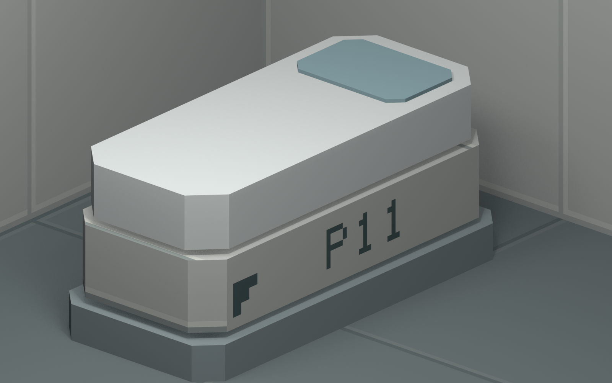

# Room 1 局部低模与像素贴图小样 v1

状态：**待美术审查；技术管线样本，不是批准的最终资产。**

执行依据：GitHub main `766411e0926511fb77635e5307039927dc960874` 中的
[制作 Brief](../../ROOM1_LOW_POLY_PROTOTYPE_BRIEF.md)、ART_DIRECTION v0.44、
[Pixel Canals 研究](../../PIXEL_CANALS_REFERENCE.md) 和已验收 Room 1 工程参数。
仅制作墙角、地面、一件 P11 占位舱、静态比例柱与审查相机。现有工程未改动。

## 打开与复现

- `room1_lowpoly_sample_v1.blend`：Blender 5.0.1 保存；4 张测试贴图已打包，路径同时改为相对路径。可编辑几何、材质槽、UV、两台 Camera 和两盏预览光。
- `build_sample.py`：从空场景重新生成；重复运行不会叠加物体。会更新本目录的样片、贴图、三张图和参数清单。
- `check_saved.py`：重新读取保存的 blend 做静态检查，输出 `self_check.json`，不保存或改变该工程。
- `sources/room1_v2_parameters.json`：上述提交的 `docs/cad/cryo_room1/v2/cad_validation.json` 原始快照，供生成器取 P11 坐标。
- `textures/`：可编辑的测试 PNG 与右长侧面的 UV 轮廓 SVG；SVG 只显示编号所在面，不是全部 UV 展开。

在本目录打开 PowerShell，按本机 Blender 安装位置执行：

```powershell
& 'C:\Program Files\Blender Foundation\Blender 5.0\blender.exe' --background --factory-startup --python .\build_sample.py
& 'C:\Program Files\Blender Foundation\Blender 5.0\blender.exe' --background --factory-startup --python-exit-code 1 --python .\check_saved.py
```

正常查看工程时可用 Numpad 0 进入整体 Camera；从 Scene Camera 切换到 `Camera_C_pixel_surface_close` 可检查侧面编号。整体图中的八棱柱高 1.68 m，仅作比例标记，无角色／绑定功能。

## 三张实际输出

以下是 Blender EEVEE 对本场景的真实 Camera 渲染，分辨率均为 1600 × 1000；并非编辑器界面截图，也没有生成式绘图或后期拼合。

### A：局部整体 Camera



### B：同 Camera，统一灰材质，去除表面贴图



### C：表面近景



C 为贴图审查临时隐藏比例柱，避免挡住编号；没有移动舱体。保存的工程恢复 A Camera、正常材质和比例柱显示。

## 尺寸与几何来源

采用工程坐标：外包前左角为原点，+Y 朝后墙，单位为米。

| 项目 | 本轮处理 |
| --- | --- |
| 房间外包 | 继承 21.0 × 9.5 m，未建立完整房间 |
| P11 | 外包最小角 (1.25, 6.50, 0)，宽 × 长 × 高 = 1.05 × 2.30 × 1.00 m |
| 地面裁片 | X=0.20…4.70，Y=5.50…9.30，厚 0.10 m，顶面 Z=0 |
| 左／后墙 | 内表面 X=0.20、Y=9.30，墙厚 0.20 m；样片墙高暂用 3.40 m |
| 后端余量 | P11 末端 Y=8.80 至后墙内面 9.30，0.50 m |
| 侧向间隙 | 按现有工程相邻舱间 0.70 m 放比例标记；未新增第二件舱 |

底座、内收主体、舱盖、头部观察区的体量与倒角沿用现有 `layout.py` 简化占位逻辑：底座高 0.20 m；主体 Z=0.24、高 0.40；盖 Z=0.68、高 0.30；观察区 Z=0.98、高 0.02。两处 0.04 m 高度空档是继承的工程占位分层，**不得当作最终深槽或产品外观设计**。观察区目前是哑光不透明色块，不代表最终玻璃方案。

真实几何承担：外包、切角轮廓、层次内收、厚度与遮挡。未使用细分、法线贴图或装饰性机械件。场景共 8 件 mesh：3 件墙／地面、4 件舱分层、1 件比例标记。

## 贴图与 UV 的暂定方法

- 墙、地面、舱主体使用 128 × 128 PNG，面投影密度暂用 32 texels/m。
- 编号所在右长侧面使用独立材质槽与 256 × 32 PNG，暂用 64 texels/m。P11 是手写 5×7 格字形按 2 texels/格绘制，仅证明编号可读，不是批准的编号字体。
- 墙／地面每 64 texels 的测试线对应约 2 m 间隔；它们是平面色带，没有真实凹槽。侧面的阶梯形标记也只存在于贴图中，没有新增 mesh。
- 图像采样为 Closest；材质为哑光 Principled、金属度 0、粗糙度 0.88。使用中性色面，未引入磨损噪点。预览区域光不代表室内设备或剧情照明。
- UV 按每个面的主轴做平面投影，相同表面有意复用区域；不是唯一展开或烘焙 atlas。切角斜面会有投影密度压缩，正式贴图前需要重新展开或按面长补偿。当前编号所在平直长面无此压缩。
- Camera A 为正交候选，俯角约 27.1°，ortho scale=6.2；Camera C 仅供近景审查。没有把镜头作为最终游戏参数。

上述分辨率、密度、颜色、字形、镜头和灯光均是本次测试值，**不构成项目统一规格**。

## 检查结果与视觉问题

保存后的 readback 检查见 [self_check.json](self_check.json)：尺寸／坐标、8 件 mesh、有限 UV、侧面材质槽、4 张 Closest 图像、打包与相对路径、Camera 恢复状态、三张 PNG 尺寸。它只证明文件中的结构与输出属性，不能证明玩法或美术通过。

对三张实际图的人工观察：

1. B 中墙面、地面、低矮卧式舱可以分开读；切角与实体层次不依赖贴图。A 中墙／地面接缝和编号能读出，C 中字形与阶梯标记的像素边界可见。
2. A 的比例柱会局部遮挡舱侧；C 隐藏后可完整看清编号。柱子只能说明静态尺度，不能验证人体自然站立、转身或上下舱。
3. 当前面与光照存在连续渐变、软阴影和屏幕抗锯齿，**整体仍偏普通低模 3D，尚未达到目标 2D 像素观感**。Closest 只解决贴图采样，不能令全画面自动成为统一像素网格。
4. 工程占位分层仍有箱状／棺状印象；后续需单独审查休眠舱轮廓和盖结构。本轮不把这种外观批准为母版设计。
5. 表面测试线较规整、偏示意图；缺少经过设计的有限明暗色块和功能区域。下一次正式美术迭代应先确定层次与色面，避免依靠噪点增加复杂度。

尚待原型验证：目标镜头下的 texel 密度、斜面 UV、统一画面像素尺度、有限明暗／非写实材质处理、像素与运动时的稳定性、实体交互遮挡。没有迁移 Godot，也未验证开盖、人物动作、碰撞或 10/28 可玩目标。

## 来源与结束点

测试图像由本目录脚本确定性绘制，无第三方素材；仅采用 Pixel Canals 研究提炼的一般几何／贴图分工方法，没有提取或使用参考作品的模型、贴图或截图作为资产输入。

本轮到局部样片、三张证据图和 GitHub 交付为止。等待用户审查轮廓、像素表现与复杂度后，才开展另一轮设计或整室扩展。
