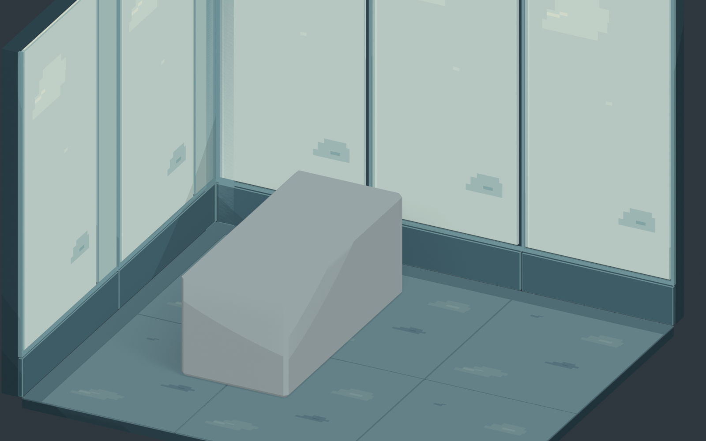
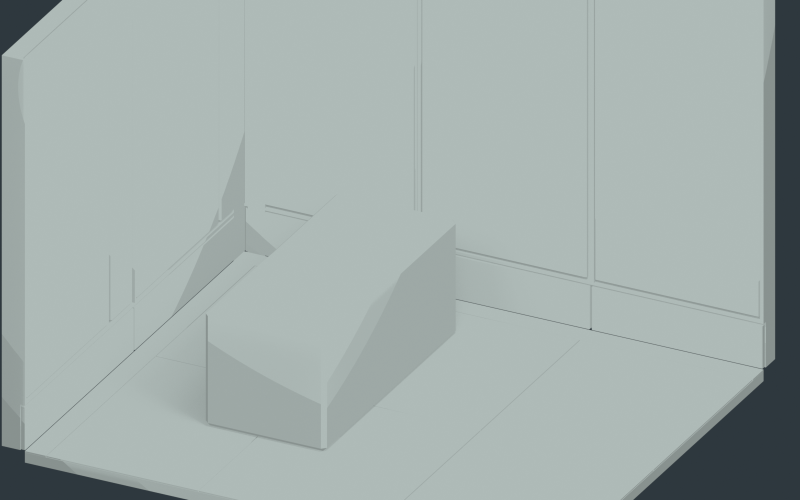
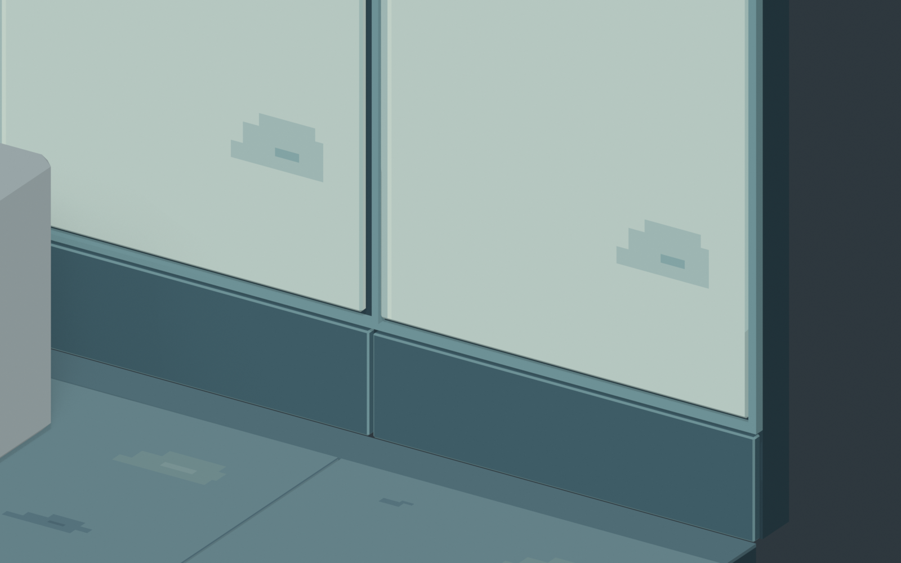

# Room 1 建筑美术重做小样 v2

**待审图。** 执行 GitHub main `2412522ebd92b1e5efc9525992001cbf2bdf2e94` 的
[ROOM1_LOW_POLY_ART_REWORK.md](../../ROOM1_LOW_POLY_ART_REWORK.md)，以 ART_DIRECTION v0.44 为方向。
v1 保留原样；本目录是独立局部美术实验。没有扩展完整房间或迁移 Godot。

## 从 v1 改了什么

| v1 | v2 |
| --- | --- |
| 整块墙／地面上画测试网格 | 独立铺板、墙面盒式面板、安装接缝、下部可维护条带、墙角 L 形收边 |
| 继承工程占位舱的三层切角结构 | 一个连贯的中性比例占位，仅保留外包与坐标 |
| 单纯测试线和编号 | 原创有限色板、按位置绘制的材料色块与阶梯像素簇；不再在舱体上画细节 |
| 平滑 Principled 光照 | Blender EEVEE 三档明暗试验，降低连续高光和大面积平滑渐变 |

**FreeCAD 提供量化空间数据，不提供游戏美术造型。** 本生成器没有导入 FreeCAD、v1 mesh、旧 `layout.py` 或其中的拓扑／几何函数。建筑模块在本轮重新构建；舱体不是产品设计候选。

## 三张实际图

都是本 blend 的真实 Camera 渲染，1600 × 1000，未经图像生成、拼贴或后期改绘。整体 A 与 v1 使用相同 Camera，便于与 [v1 整体](../room1_lowpoly_v1/evidence/A_target_camera.png) 比较。B 同位置去除全部贴图／材质颜色，C 放大墙板与地面连接处。

### A：建筑模块组合与中性舱体占位



### B：统一无纹理灰材质，查看实际建筑结构



### C：像素簇、模块边缘与表面分区近景



保存工程恢复 Camera A、正常材质。C 不隐藏或移动模型。

## 借用的工程数据

[engineering_reference.json](engineering_reference.json) 只记录来自已验收工程的数字。

- 房间外包 21.0 × 9.5 m；内墙边界 X=0.20、Y=9.30，墙厚 0.20 m。
- 局部地面裁片沿用 v1：X=0.20…4.70，Y=5.50…9.30，地面顶标高 Z=0、厚度 0.10 m。
- 墙高 3.40 m 是现有 blockout 的暂定值。
- P11 占位最小角 (1.25, 6.50, 0)，宽 × 长 × 高 1.05 × 2.30 × 1.00 m，长轴沿 Y。
- 原门位、20 舱与十字通道并未进入这个局部模型，也未改动；局部坐标可以放回工程。
- Camera A 沿用 v1 的位置、朝向、正交 scale=6.2，俯角约 27.1°；仍是候选展示镜头。

以上不会让 FreeCAD 的舱盖分层、切角、缝隙成为美术母版。

## 完全重新制作的建筑美术

| 模块 | 真实 mesh 及其必要性 | 贴图承担 |
| --- | --- | --- |
| 连续地面基层 + 6 件铺板 | 提供连续支承与独立替换的板块；顶面 Z=0；板间约 8 mm 安装缝，3 mm 边缘折角，让接合产生真实厚度与遮挡 | 矿物复合面层的少量压缩色簇与色阶，非随机污渍 |
| 地面周边材料带 | 0.18 m 宽、齐平铺设；和铺板几何分开，无抬高或重叠顶面；给墙脚收口和切板区域一个清晰材料边界 | 单色克制处理，避免新增装饰纹理 |
| 上部墙面盒式面板 | 正面保持内墙边界；小边缘折角、背后内嵌支承、独立竖向安装缝；面板由 1.50 m 名义宽度组织，左墙局部用窄边板收口 | 面层颜色、像素阶梯亮／暗簇，局部涂层色差 |
| 下部可维护条带 | 约 0.38 m 高，独立接合，表达可替换与墙脚清洁维护分区；不当作新增设备或管线 | 低明度哑光材料区分，不加机械图案 |
| 墙角 L 形收边 | 封闭两侧面板端口；凹角切面向墙体内部退让，全部位于工程墙体包络内 | 独立浅灰蓝材料，不靠贴图假造厚度 |

新增细节只为模块装配、清洁维护、材料分区或轮廓阅读服务。没有外突墙饰、设备、灯带、管线、角色、门、舱盖或观察窗。

## 原创像素与暂定材质方法

- 墙面颜色图 `wall_clusters_96x192.png`：5 色，主体留大块清洁面，少量亮簇／暗簇沿阶梯轮廓组织。地面 `floor_clusters_96x120.png`：5 色，压缩成横向短簇，保持走路区域平静。
- 全部像素由脚本中明确坐标的矩形组合手动安排，无随机噪点。可编辑色板与簇坐标保存在 [textures/pixel_sources.json](textures/pixel_sources.json)；可直接编辑 PNG 或在 Aseprite 中另存带图层版本。本轮没有伪称提供 `.aseprite` 母版。
- 颜色是本次实验的冷灰蓝、灰绿与淡陶瓷色，不是项目批准色板。材质名称是候选表达，不代表世界设定已确认具体配方。
- 正面和顶面采用按实际长度的平面 UV，暂用 **64 texels/m**。对齐图像宽高使正面不会拉伸；切角／折边使用独立纯色材质，避免把平面像素拉到斜面。所有 mesh 都只有一个显式启用的 UV 层。
- 图像采样 **Closest**、边界 **Extend**。相同模块复用同一色图；没有额外几何凹槽来模拟色簇。纯色边板与收口保留替换材质槽的能力。
- 使用本项目自拟的 **EEVEE Diffuse → Shader to RGB → Constant 三档色阶 → 乘颜色图 → Emission** 节点试验。它是 Blender 的审查方案，**不是对 Pixel Canals Shader 的断言，也不能直接导出成等价 Godot 材质**。动态灯光、阴影与 Godot 实现须另行验证。
- 输出仍为高清 3D 图；没有统一低分辨率 Viewport 或全画面最近邻放大。贴图像素和屏幕像素并不等同。本轮不锁定逻辑分辨率。

技术参考只借用 Pixel Canals 研究中的「几何承担厚度和遮挡，手绘像素承担表面信息，控制画面明暗」方法；没有提取其模型、贴图、城市元素或色板。

## 文件、打开与复现

- `room1_lowpoly_sample_v2.blend`：可编辑场景，墙、地面美术候选与舱体工程占位分属命名 collection。
- `build_sample.py`：从空场景生成，仅写本目录，不更改 v1 或其他工程；重复执行不会叠加对象。
- `textures/`：两个原始 PNG、色板及簇坐标源数据；PNG 已打包到 blend，也保留相对路径外部文件。
- `sample_manifest.json`：实际面数、输出属性与方法范围。
- `check_saved.py` / `self_check.json`：重新读取保存工程，检查包络、标高、实际启用 UV 密度、贴图打包和输出尺寸；不证明美术已通过。

在本目录打开 PowerShell，按学校电脑的安装路径替换 Blender 路径：

```powershell
& 'C:\Program Files\Blender Foundation\Blender 5.0\blender.exe' --background --factory-startup --python-exit-code 1 --python .\build_sample.py
& 'C:\Program Files\Blender Foundation\Blender 5.0\blender.exe' --background --factory-startup --python-exit-code 1 --python .\check_saved.py
```

已用 Blender 5.0.1 保存。打开 blend 后 Numpad 0 查看目标镜头；节点材质需用 EEVEE Rendered 预览。所有纹理均为本轮原创，可由后续 PixelLab/Aseprite 资产替换。

## 审图结果与未决定事项

- 无纹理 B 中可以读出独立面板、下部条带、板缝、铺板边缘与墙角；不是用一块工程方体上画网格替代模块。
- A/C 能看到贴图簇附着在各模块表面，与真实边缘分工；没有随机满面噪点。色区比 v1 清楚，连续光照受到限制。
- 当前像素簇在相同板块上重复较明显，有些暗簇可能被读成磨损／接口而非面层色差；**具体材料绘法与色簇的功能阅读仍待审查**。不将这些图案当作新设备设定。
- Camera A 能用于与 v1 比较，但上部墙面局部超出画框，舱体占位会挡住一些地面。C 只审查较低处墙板与地面接合，不是全墙展示。
- 三档明暗和抗锯齿后的轮廓尚未形成统一屏幕像素尺度；大平面仍有 3D 空间感。局部风格改善不等于最终像素路线已经验收。
- 休眠舱最终造型、正式材质／色板、角色表现、动态光照、运动闪烁、Godot Shader、碰撞与上下舱全部未定／未验证。

**交付后等待审图。** 不自动扩展 20 舱或完整房间，也不宣称已完成 10/28 可玩目标。
