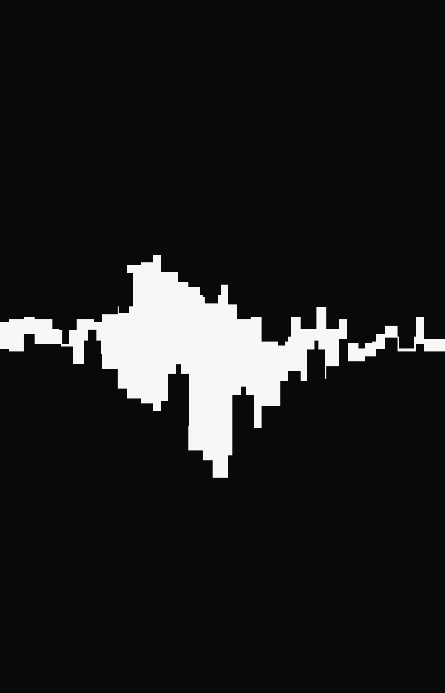

# 海报：极简城市剪影负空间 v4

2026-11-17。状态：**供构图比较的草案**，尚非定稿。对应 [海报概念](../GRADUATION_POSTER_CONCEPT.md) 及 [波形基线](WAVE_REFERENCE_V1.md)。

本次根据用户反馈压缩图形复杂度：**单一横向白色负空间、上下各一组实黑建筑轮廓**。删除先前说明图中的灰色层叠城市、管道、窗格、说明栏和变体表。保留主波上下错位、右侧弱尾波；当前尚未放标题及光回声。几何仍是抽象构图草图，未来需按本作城市语汇继续调整建筑辨识度，但不允许自动恢复多层杂乱图案。

可编辑源：`echoes_minimal_city_wave_v4.svg`。