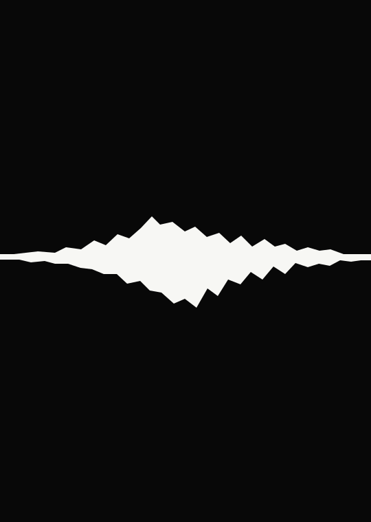

# 海报中央负空间波形参考 v1

更新：2026-11-17。状态：**供用户手绘城市剪影草稿使用的波形方向参考，非最终海报/建筑剪影**。

- 纵版画布，中间由一条**横贯左右**的浅色不规则缝隙承载“残響”意象。
- 黑色上部用于之后的**倒悬城市剪影**；下部用于**正常方向城市剪影**。本模板不绘制任何建筑；建筑由用户自己绘制。
- 左侧缝隙很窄，向中段逐渐展开；上边缘的最大上扬约在画面40%宽处，下边缘的最大下坠约在53%宽处，避免上下对称、镜像和规则声波。
- 右侧保留数个递减的小起伏，最终收束到近乎平直的窄缝。
- 当前为**一个具体推荐版本**，不是要求用户机械描摹的最终几何；用户后续可根据建筑形体微调局部转折，但保留主波的非对称节奏和左右衰减关系。
- 尚未加入光回声与标题。光回声仍需未来单独排版，不应在这一轮把声波模板直接变成音乐/音频频谱装饰。
- 总概念见 [海报概念草案](../GRADUATION_POSTER_CONCEPT.md)。

文件 `echoes_negative_space_wave_v1.svg` 为可缩放矢量母版，适合导入 Illustrator/Inkscape 等软件或作为 Procreate 参考底图。
